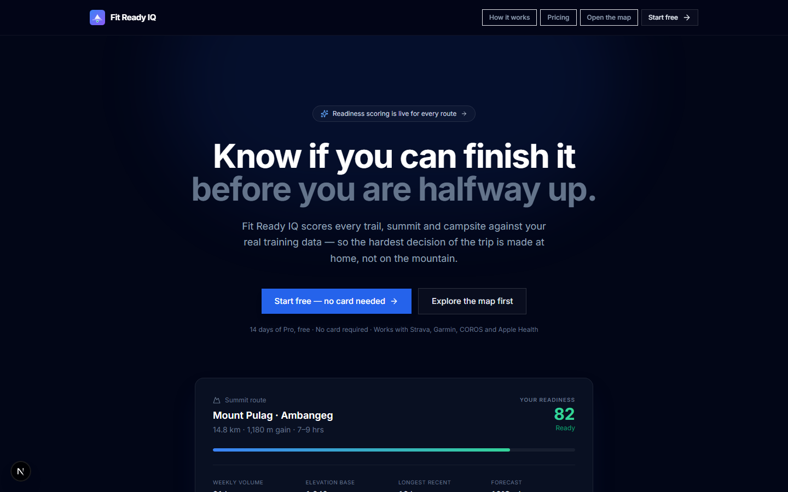
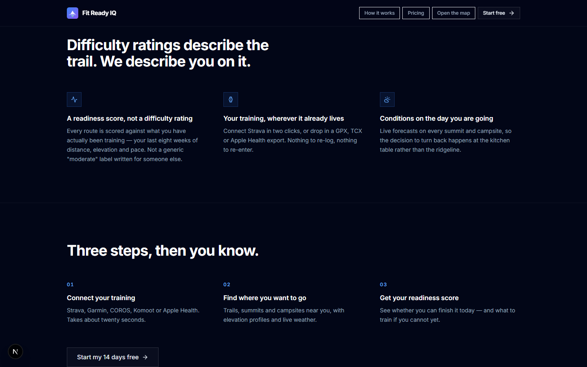
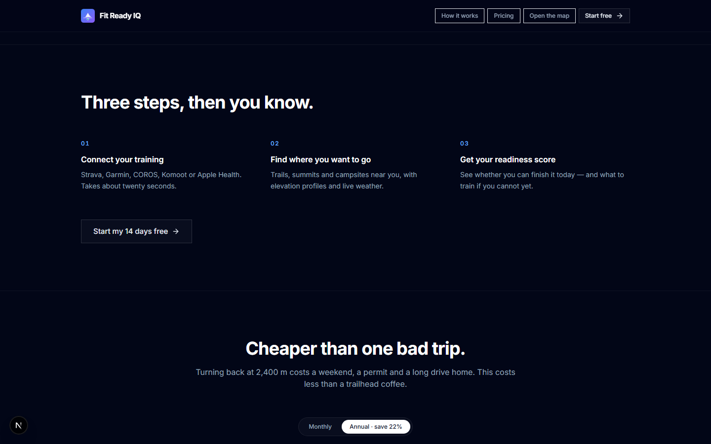
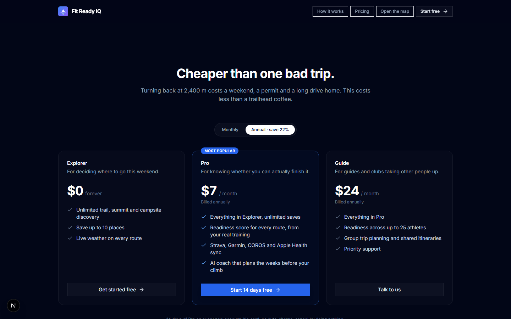
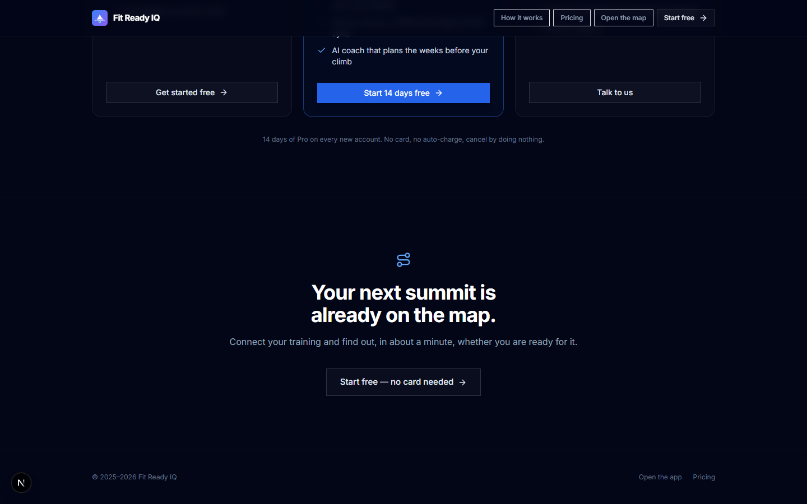
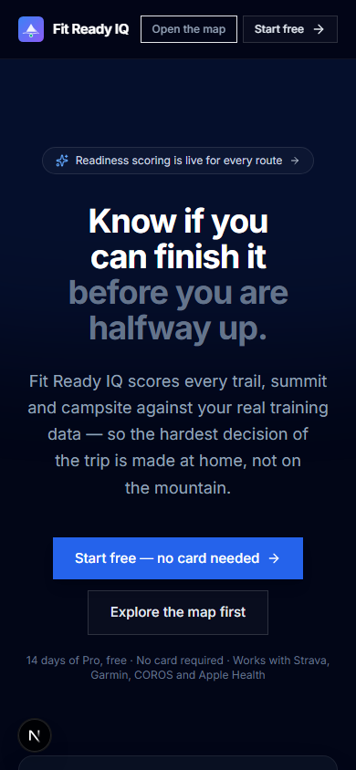
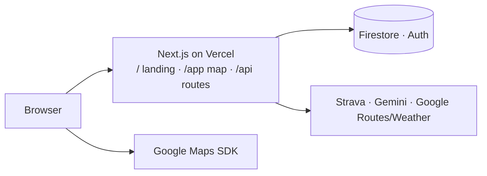

# Fit-Ready-IQ

**Am I ready for this route, and when should I go?**

Fit-Ready-IQ finds routes, peaks and campsites near you. It scores each one against your
recorded activities from Strava, GPX or Apple Health, and shows the weather window for that
route's duration. It never shows a number the data doesn't support: unknown elevation,
difficulty or readiness is displayed as unknown.



<details>
<summary>More screenshots</summary>







</details>

## Stack

Next.js 16 (App Router) on Vercel · Firebase Auth + Firestore · Google Maps, Places,
Elevation, Routes and Weather · Strava · Gemini 2.5 Flash. A FastAPI backend in
`src/backend/` follows Clean Architecture and is **not deployed**.



## Quick start

```bash
cp .env.example .env.local          # one env file for the whole repo
cd src/frontend
npm install                         # also installs the pre-commit hooks
npm run dev                         # http://localhost:4790
```

Optional: `docker-compose up -d` starts the Firestore and Auth emulators. Backend:
`cd src/backend && poetry install && poetry run uvicorn src.main:app --reload --port 8000`.

Before you push:

```bash
npm run quality && npm run test:unit      # src/frontend
poetry run ruff check . && poetry run ruff format --check . && poetry run mypy src/   # src/backend
poetry run lint-imports && poetry run vulture && poetry run pytest
```

## Layout

```
src/frontend/        Next.js app · tests/{e2e,integration,performance} · unit tests beside the code
src/backend/         FastAPI (presentation → application → domain ← infrastructure)
docs/guides/         what it is
docs/solution-plan/  how we deliver it, and what it should do
docs/adr/            why it is this way
.github/workflows/   CI (GitHub Actions)
```

## Documentation

Start at [`docs/README.md`](docs/README.md). The guides most people need first are
[architecture](docs/guides/architecture.md), [development](docs/guides/development.md),
[the quality harness](docs/guides/harness.md) and [deployment](docs/guides/deployment.md).
Agents: [`.claude/CLAUDE.md`](.claude/CLAUDE.md). Report vulnerabilities through
[`SECURITY.md`](SECURITY.md).

## License

MIT
