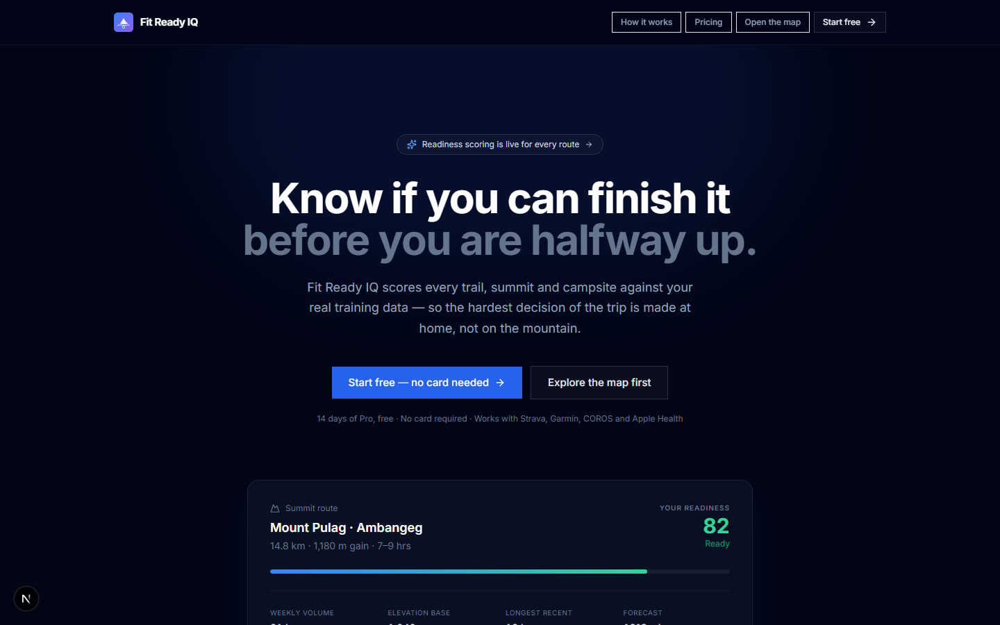
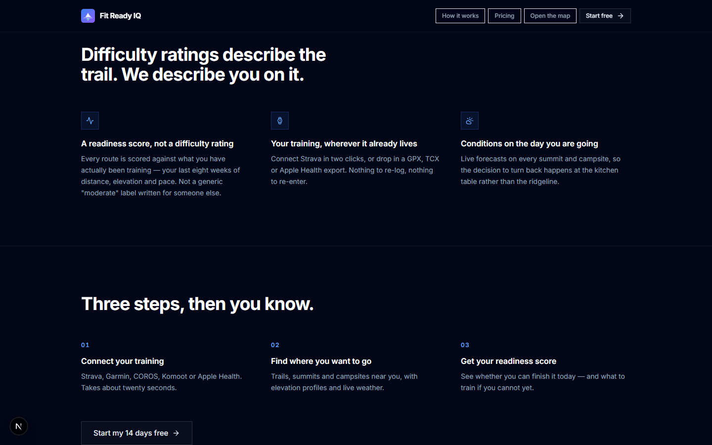
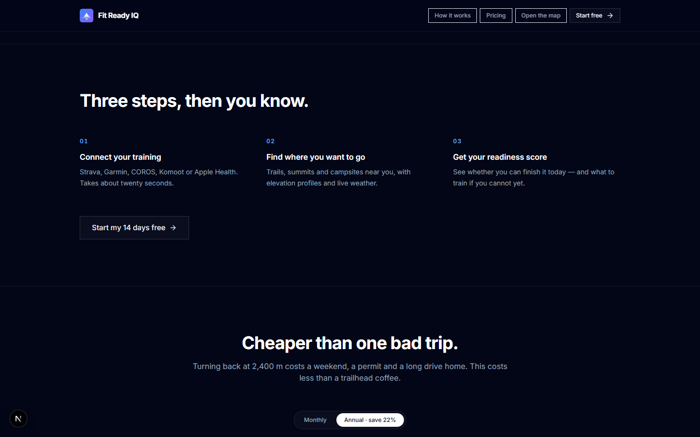
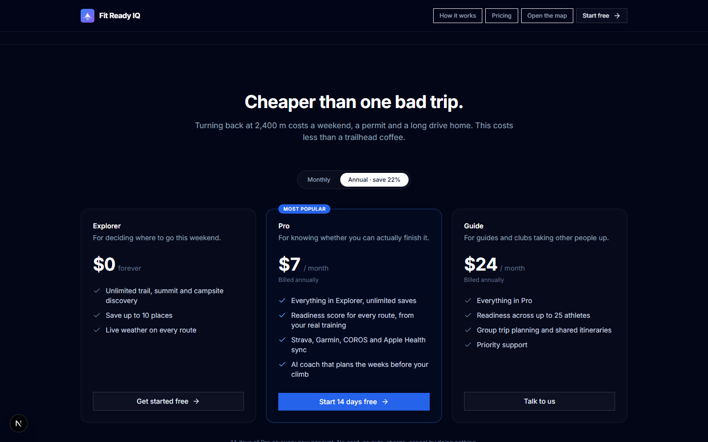
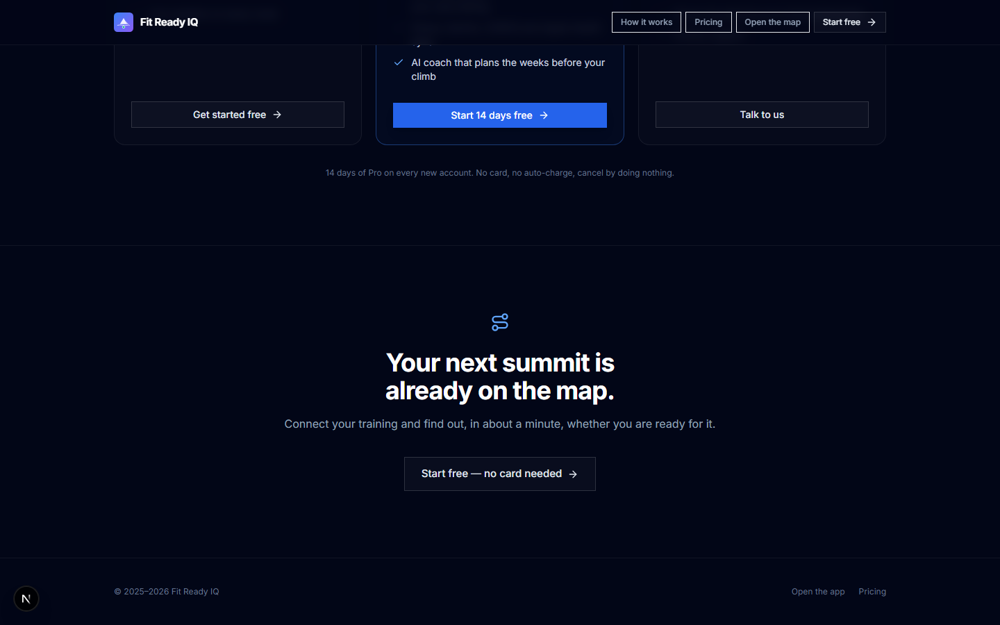
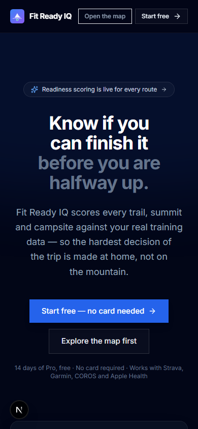
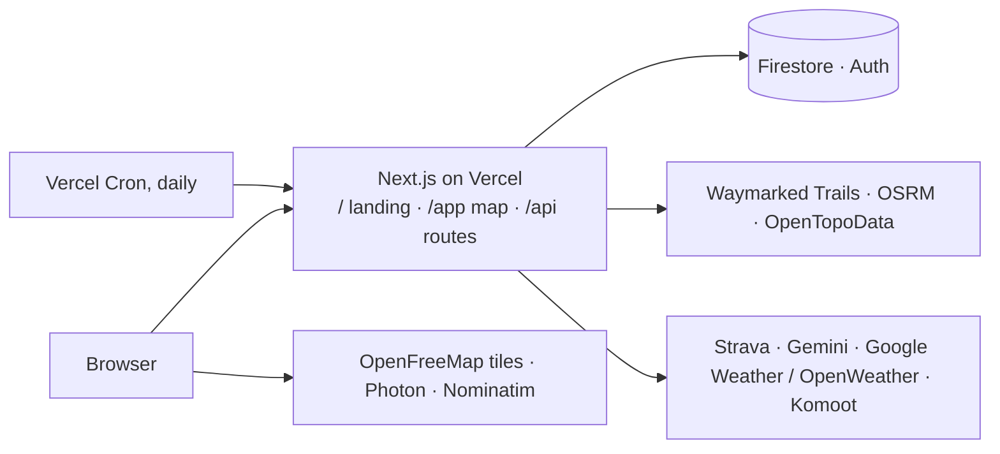

# Fit-Ready-IQ

**Am I ready for this route, and when should I go?**

[Homepage](https://www.metropolitanms.org/) ·
[Live app](https://frontend-sigma-tan-81.vercel.app) ·
[Releases](https://github.com/Oweeboi011/Fit-Ready-IQ/releases)

Fit-Ready-IQ finds routes, peaks and campsites near you. It scores each one against your
recorded activities from Strava, GPX or Apple Health, and shows the weather window for that
route's duration. It never shows a number the data doesn't support: unknown elevation,
difficulty or readiness is displayed as unknown.



<details>
<summary>More screenshots</summary>







</details>

## What it does

- **Discover**: hiking routes with measured length and climb, peaks and campsites near any
  point, from OpenStreetMap.
- **Readiness**: each route rated against your own recent activities, split into "ready"
  and "stretch".
- **Weather window**: the soonest span worth going, sized to the route's duration.
- **Plan**: a waypoint planner snapped to walking paths, with GPX export and sync across
  devices.
- **Trips**: plan a trip and check in when you're back. Nobody is alerted yet, and the app
  says so.
- **Assistant**: Gemini chat that reads the open place and its forecast, and proposes saves
  for you to confirm.
- **Imports**: Strava, GPX (Garmin, COROS, Komoot), Apple Health, and Komoot share links.

## Stack

Next.js 16 (App Router) on Vercel · Firebase Auth + Firestore (free Spark plan) ·
MapLibre on OpenFreeMap tiles · OpenStreetMap services for discovery, search, routing and
elevation · Google Weather with an OpenWeather fallback · Strava · Gemini Flash. No Google
Maps key, and no Google script in the browser. A FastAPI backend in `src/backend/` follows
Clean Architecture and is **not deployed**. Its image is published with each release.



The free OpenStreetMap services are proxied and cached at the edge. A daily cron deletes
expired data in place of Firestore TTL, which would need a paid plan
([runbook](docs/guides/runbooks/expiry-sweep.md)).

## Quick start

```bash
cp .env.example .env.local          # one env file for the whole repo
cd src/frontend
npm install                         # also installs the pre-commit hooks
npm run dev                         # http://localhost:4790
```

Optional: `docker-compose up -d` starts the Firestore and Auth emulators. Backend:
`cd src/backend && poetry install && poetry run uvicorn src.main:app --reload --port 8000`.

Before you push, run the gates in [harness.md](docs/guides/harness.md#running-it).

## Releases

`feature/*` → `develop` → `main`. Each merge to `main` is a production release: Vercel
deploys it, and [`release.yml`](.github/workflows/release.yml) tags it `vYYYY.MM.DD`,
publishes generated release notes, and pushes the backend image to
`ghcr.io/oweeboi011/fit-ready-iq-backend`. See [deployment](docs/guides/deployment.md).

## Layout

```
src/frontend/        Next.js app · tests/{e2e,integration,performance} · unit tests beside the code
src/backend/         FastAPI (presentation → application → domain ← infrastructure)
docs/guides/         what it is
docs/solution-plan/  how we deliver it, and what it should do
docs/adr/            why it is this way
.github/workflows/   CI, E2E, security, mutation, uptime, release
```

## Documentation

Start at [`docs/README.md`](docs/README.md). The guides most people need first are
[architecture](docs/guides/architecture.md), [development](docs/guides/development.md),
[the quality harness](docs/guides/harness.md) and [deployment](docs/guides/deployment.md).
Agents: [`.claude/CLAUDE.md`](.claude/CLAUDE.md). Report vulnerabilities through
[`SECURITY.md`](SECURITY.md).

## License

MIT
