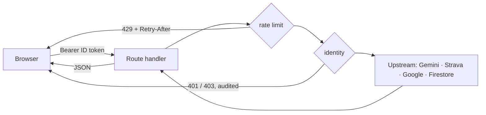

# API

Every server route lives under `src/frontend/src/app/api/`. Timeouts are set in
`vercel.json`. The route table in [`.claude/CLAUDE.md`](../../.claude/CLAUDE.md) is the
quick index; this page is the contract.

## Conventions every route follows

| Concern | Rule | Where it lives |
|---|---|---|
| Identity | `requireUser(request)` or `optionalUser(request)` verifies a Firebase ID token. A `uid` in a body or query string is never an identity, because the Admin SDK bypasses Firestore rules | `lib/serverAuth.ts` |
| Admin | `requireRole(request, 'viewer' \| 'admin')`. Every denial is audited | `lib/adminAuth.ts`, `lib/auditLog.ts` |
| Rate limits | One budget per route, declared in a single table. Callers are keyed by **verified uid**, else by IP. `rateLimitCoverage.test.ts` fails the build on a route with no budget | `lib/rateLimitRules.ts` |
| Errors | `{ "error": "<human-readable>" }`. Upstream bodies are logged (redacted), never returned | `lib/logger.ts` |
| Logs | One JSON line per event, with `request_id` from `x-vercel-id`. Never `console.*` (ESLint-gated) | `lib/logger.ts` |



| Status | Meaning for a client |
|---|---|
| 400 / 413 | Fix the request; do not retry |
| 401 / 403 | Sign in again / not permitted |
| 409 | State conflict (for example, Strava not connected) |
| 429 | Wait for `Retry-After` |
| 502 / 504 | Upstream failed or timed out; retry with backoff |
| 503 | Not configured; retrying will not help |

## Routes

### POST /api/chat

**Description:** Sends the user's turn to Gemini 2.5 Flash and returns the reply.

**Identity:** optional. A signed-in caller sends `Authorization: Bearer <Firebase ID token>`
(the widget uses `optionallyAuthedFetch`). Rate-limited to 20/hour per verified uid, or per IP
when signed out.

**History is not taken on trust.** For a session the server already holds, the model context is
rebuilt from `chat_sessions/{id}/messages` and only the client's final turn is used; the client
could otherwise write the assistant's side of the conversation. For a new session, the client's
last 20 messages are used (trimmed to start on a user turn).

**Persistence:** signed-in conversations only. The owner is written once, at create; a
`sessionId` that is unknown, malformed or someone else's gets a fresh server-minted id instead.
Signed-out conversations are not stored — there would be no owner to export or erase them for —
and the response then carries no `sessionId`. Stored turns expire after 90 days (TTL).

**Request:**

```http
POST /api/chat
Content-Type: application/json
Authorization: Bearer <Firebase ID token>   (optional)

{
  "sessionId": "8c1f…-uuid",
  "messages": [{ "role": "user", "content": "What gear do I need for Mt. Pulag in December?" }]
}
```

| Field | Type | Required | Description |
| --- | --- | --- | --- |
| `sessionId` | string (UUID) | No | A session this caller owns. Anything else is replaced by a new id. |
| `messages` | array | Yes | 1–200 messages; the **last must be `role: "user"`**. Each at most 8,000 characters. |

**Responses:**

| Status | Body | Condition |
| --- | --- | --- |
| 200 | `{ "message": "…", "sessionId": "…" }` | Signed in |
| 200 | `{ "message": "…" }` | Signed out (nothing stored) |
| 400 | `{ "error": "Invalid request body" \| "Messages array required" \| "Invalid message format" }` | Malformed, or the last turn is not the user's |
| 413 | `{ "error": "Request too large" \| "Too many messages" \| "Message too long" }` | Body over 256 KB, >200 messages, or a message over 8,000 chars |
| 429 | `{ "error": "Too many requests…" }` + `Retry-After` | Budget spent |
| 502 | `{ "error": "AI service unavailable" }` | Gemini refused |
| 503 | `{ "error": "AI assistant is not configured…" }` | `GEMINI_API_KEY` not set |
| 504 | `{ "error": "AI service timed out" }` | Gemini exceeded 20 s |

### POST /api/strava/exchange

**Identity:** required. Body `{ "code": "<Strava authorization code>" }`. The server swaps the
code for tokens, stores them in `strava_tokens/{uid}` (`lib/stravaTokens.ts`) and returns only
the connection: `{ connected, athleteId, athleteName, connectedAt }`. The token payload never
reaches the browser. The OAuth `state` nonce is checked client-side in the callback page.

| Status | Condition |
|---|---|
| 200 | Connected |
| 400 | Missing code, or Strava rejected it |
| 502 | Strava answered without a usable connection |
| 504 | Strava unreachable |

### GET /api/strava/activities

**Description:** One page of the caller's Strava activities.

**Identity:** required — `Authorization: Bearer <Firebase ID token>`. The Strava credentials are
held server-side in `strava_tokens/{uid}` (`lib/stravaTokens.ts`) and never reach the browser;
there is no token parameter.

```http
GET /api/strava/activities?page=1
Authorization: Bearer <Firebase ID token>
```

| Status | Body | Condition |
| --- | --- | --- |
| 200 | Array of Strava activity objects | |
| 401 | — | No valid Firebase ID token |
| 409 | `{ "error": "Strava is not connected…" }` | Never connected, or Strava refused our token (it is then forgotten) |
| 502 | `{ "error": "…" }` | Strava failed, or timed out (10 s) |
| 503 | `{ "error": "…" }` | Strava rate-limited us (its 429) |

### GET /api/weather

`?lat=&lng=` (required), `&elevation=` and `&hours=` (route duration, at most ten days;
optional). Uses Google Weather when `GOOGLE_WEATHER_API_KEY` is set, falling over to OpenWeather (if
configured) when Google fails.
Returns current conditions plus `alerts` and `window`, the soonest span worth going for a route
of that duration (`lib/weatherWindow.ts`). CDN-cached for 30 minutes. Returns 503 when neither
key is set and 502 when the provider fails. No Firestore cache exists.

### GET /api/health

Public, and checks only that credentials are **present**; it makes no live calls. Services:
`maps`, `firebase_client`, `firebase_admin`, `gemini`, `weather`, `routing`, `strava`,
`rate_limiting`. Status is `healthy` (0 failing), `degraded` (1–2, HTTP 200) or `unhealthy`
(3+, HTTP 503). It names no project or client id. `uptime.yml` polls it.

### /api/places/cache

- `GET ?lat=&lng=`: public. Returns the cell's routes, mountains and campsites if fresh (24 h),
  else 404 `{ hit: false }`. Cells are 0.5° (`lib/placesCacheSchema.ts`, versioned by
  `PLACES_CACHE_VERSION`).
- `POST`: identity required. Every item is rebuilt through the schema module, with at most 200
  per kind. While a cell is fresh, only the account that filled it may refresh it (409 for
  anyone else).

### GET /api/integrations/firebase

Admin only. A deep probe that writes to Firestore. Use `/api/health` for uptime instead.

### /api/admin/cache

**Identity:** `requireRole` — `viewer` for GET, `admin` for DELETE. Every denial is audited.

- `GET` — cache entries with freshness.
- `DELETE ?gridKey=<key>` — deletes one entry.
- `DELETE ?all=true` with body `{"confirm":"PURGE"}` — deletes every entry (batches of 400).
- Anything else — including an empty `gridKey`, which used to fall through to a full purge — is a 400.

Every purge, successful or failed, is written to `audit_logs`.


### GET /api/admin/strava-sync

**Identity:** `requireRole(…, 'viewer')`. Returns each user's `strava_sync` manifest:
`last_synced_at`, `total_activities` (the count stored, not the last run's) and up to five errors.


### /api/strava/connection

**Identity:** required. `GET` returns `{ connected, athleteId, athleteName, connectedAt }` — never a
token. `DELETE` forgets the stored tokens (disconnect).

### POST /api/strava/sync

**Identity:** required; the destination uid comes from the token. Copies up to 300 activities into
`users/{uid}/strava_activities`. Each page is written in a transaction that re-checks the Strava
connection still exists, so a sync running during a disconnect or account erasure stops rather
than writing data back. 409 when not connected (including mid-sync); 503 if the token lookup fails.

### GET /api/account/export, POST /api/account/delete

GDPR Art. 15 and 17. Identity required; 5/hour. Both walk `lib/userDataFootprint.ts`.
Delete requires `{"confirm":"DELETE"}` and runs: revoke the grant at Strava → delete the Strava
tokens → erase the user tree and owned collections → delete the Auth account last. A failure stops
before the Auth account, so the user can retry; the audit record says how far it got.

### POST /api/directions

Google Routes proxy. `origin`, `destination` (`{lat,lng}`, range-checked), optional
`intermediates` (first 25 used), `mode` (`DRIVE` | `WALK` | `BICYCLE`). Returns
`{ polyline, distanceKm, durationSeconds }`; the two numbers are `null` when Routes did not report
them. 120/hour.

### GET /api/advisories

`data/advisories.json`, then `ADVISORY_FEED_URL`. `{ configured: false }` when neither exists —
never "all clear". A present-but-unreadable file, or a failing feed, is a 502 with
`configured: true` and an `error`. Only `https:` advisory links are accepted.

### GET /api/admin/whoami, GET /api/admin/users

`whoami` returns `{ isAdmin, role }` for the bearer token (300/hour; plain "not an admin" is not
audited). `users` lists Firebase Auth accounts for admins, capped at 1,000 with `truncated`.
