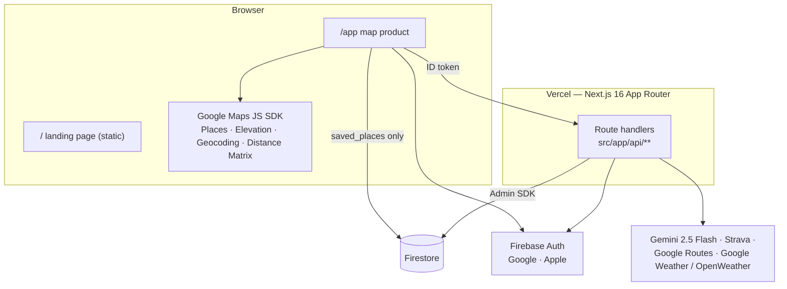
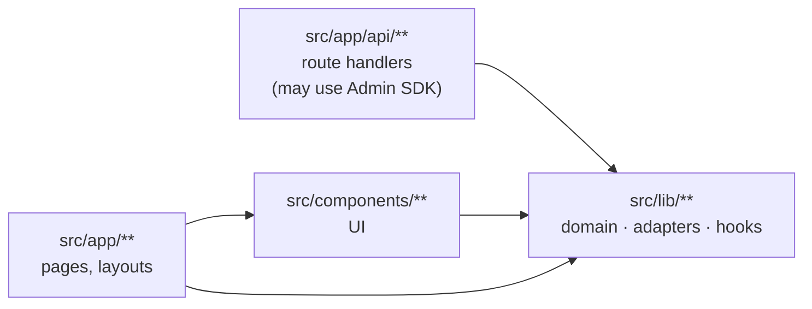
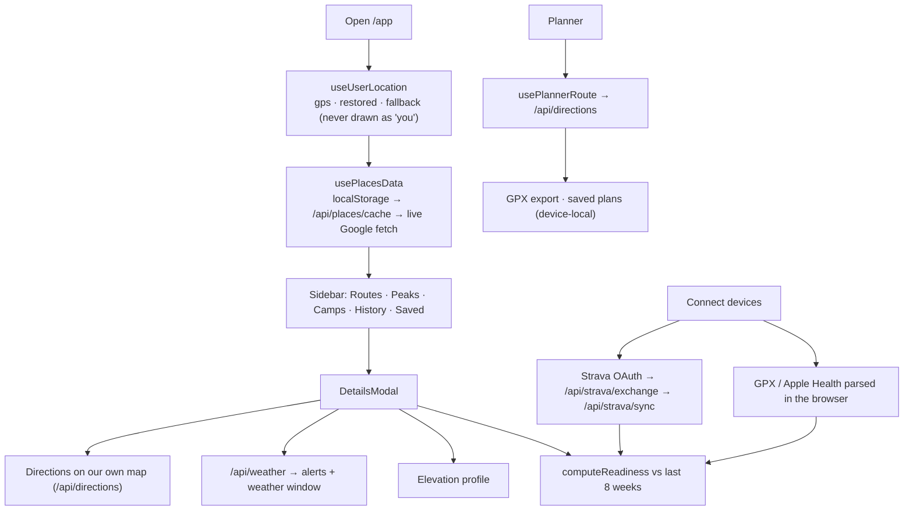
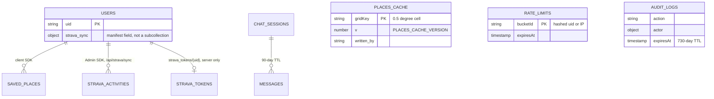
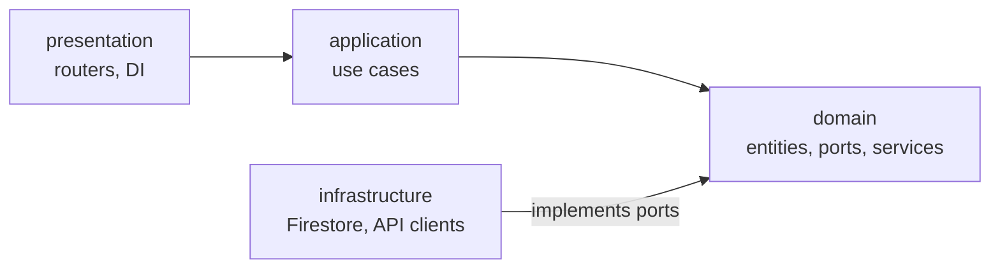

# Architecture

Fit-Ready-IQ helps outdoor athletes answer one question: _am I ready for this route, and when
should I go?_ It finds routes, peaks and campsites; scores them against the athlete's recorded
activities; and shows the weather window for that specific route. The vocabulary (Trip, Route,
Place, Activity, Readiness, Weather window) is defined in [`CONTEXT.md`](../../CONTEXT.md).

## System

- **`/` is static and fast.** It is the only page that converts visitors, so it ships no
  Firebase in its first bundle. The product lives at `/app`.
- **The browser talks to Google directly** for discovery, using a referrer-restricted key.
  Everything that needs a secret goes through a route handler.
- **The backend in `src/backend/` is not deployed.** Nothing in production calls it (see
  [Backend](#backend-not-deployed)).

## Frontend layers

Dependencies point inward only. `dependency-cruiser` enforces the layers and ESLint enforces
the credential boundary ([harness](harness.md)).

| Layer             | Holds                                                                       | Rule                                                                                                                                                                                   |
| ----------------- | --------------------------------------------------------------------------- | -------------------------------------------------------------------------------------------------------------------------------------------------------------------------------------- |
| `src/lib/`        | Parsers, scoring, caches, hooks, server-only modules                        | Imports nothing above it. Server-only modules (`firebaseAdmin`, `serverAuth`, `adminAuth`, `stravaTokens`, `rateLimit*`, `auditLog`, `logger`) are importable only from route handlers |
| `src/components/` | UI. `Modal`, `ConfirmDialog` and `ui.ts` buttons are the shared primitives  | Never imports a page or route                                                                                                                                                          |
| `src/app/`        | `page.tsx` composes hooks and components; `app/app/page.tsx` is wiring only | —                                                                                                                                                                                      |

Rules the UI holds to (from [`.claude/CLAUDE.md`](../../.claude/CLAUDE.md)):

- **Never render a number the data does not support.** Elevation, difficulty, weather,
  readiness and advisories each have an explicit unknown state.
- **Failures are sayable.** A failed fetch names itself and offers a retry.
- **One primary action per viewport.** Every dialog is built on `Modal`.

## Core flows

Signing in is never needed to browse. It gates saving places, Strava and chat history.
`?place=kind:id` deep links (`lib/placeUrl.ts`) reopen a place after a reload or share.

### Readiness

`computeReadiness()` (`lib/readiness.ts`) runs in the browser. The score is the **worst** of
three factors, never their average, and the summary names that limiting factor:

| Factor         | Your capacity                      | The route's demand                            |
| -------------- | ---------------------------------- | --------------------------------------------- |
| Longest outing | Longest single activity in 8 weeks | Route distance                                |
| Weekly volume  | Average weekly distance            | Half the route distance per week              |
| Biggest climb  | Largest single ascent              | Route ascent (skipped and flagged if unknown) |

Bands: `ready` ≥ 80, `nearly` ≥ 60, `build` ≥ 40, `not-yet` below that, and `unknown` with
no activities. `readinessRecommender.ts` sorts the ready band by demand, not score: everything
easy scores 100, so sorting by score would surface the flattest walk.

### Chat

`/api/chat` makes one prompt-completion call to Gemini. It uses no tools and no route or
weather grounding. For a session it already stores, the server rebuilds the history from
Firestore and never trusts the client's copy. Only signed-in conversations are stored, with a
90-day TTL. Agentic tool use (save or analyse a route) is planned; see the
[solution plan](../solution-plan/SOLUTION-PLAN.md).

## Data

| Collection                                          | Written by               | Notes                                                                                      |
| --------------------------------------------------- | ------------------------ | ------------------------------------------------------------------------------------------ |
| `users/{uid}/saved_places`                          | Browser                  | The only browser write. Rules do not cascade, so every subcollection needs its own `match` |
| `users/{uid}/strava_activities`                     | `/api/strava/sync`       | Upsert by Strava id. Each page is a transaction that re-checks the connection              |
| `strava_tokens/{uid}`                               | `/api/strava/exchange`   | Never readable by any client                                                               |
| `places_cache/{gridKey}`                            | `/api/places/cache` POST | Shared and public-read. The first writer wins while fresh (24 h)                           |
| `chat_sessions/…/messages`                          | `/api/chat`              | Signed-in only                                                                             |
| `rate_limits`, `audit_logs`                         | Server                   | Append-only audit trail                                                                    |
| `activities`, `routes`, `training_*`, `itineraries` | No live writer           | Rules and erasure cover them ahead of ADR-0003 (Trip) and ADR-0004 (geometry)              |

- **TTL.** `rate_limits`, `chat_sessions` (plus `messages` at collection-group scope) and
  `audit_logs` need a Firestore TTL policy on `expiresAt`; see
  [runbooks/firestore-ttl.md](runbooks/firestore-ttl.md).
- **User data.** Every user-scoped collection is listed in `lib/userDataFootprint.ts`. Export
  and erasure both walk that list, so a new collection goes there in the same change.
- **Polylines.** They are stored as `[lng, lat]` (GeoJSON order).

### Browser caches

| What            | Where                                                         | TTL             |
| --------------- | ------------------------------------------------------------- | --------------- |
| Places          | `localStorage` `fri_places_cache`, keyed on the 0.1° location | 24 h            |
| Reverse geocode | `sessionStorage` `fri_geocode_*`                              | 24 h            |
| Weather, photos | Module memory in `DetailsModal`                               | 30 min, session |
| Last location   | `localStorage` `fri_last_location`, restored in an effect     | —               |

Sign-out clears every personal `fri_*` key (`lib/personalStorage.ts`, classified by test).

## Backend (not deployed)

`src/backend/` is FastAPI built on Clean Architecture, and **import-linter** enforces it in CI
and in `tests/unit/test_architecture.py`:

The domain imports no framework (fastapi, firebase_admin, httpx, pydantic-settings). One
endpoint is wired: `GET /api/routes/best-fit` (`MatchRoutesUseCase`). The Strava, Garmin,
COROS, Komoot and Google Maps clients are kept on purpose and are waiting on a use case or on
partner access. Configuration is read only through `config/settings.py`; ruff bans `os.environ`
elsewhere.
