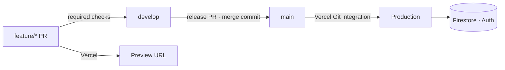

# Deployment

Production is **Vercel**, deploying `src/frontend` from Git. Firebase (Firestore + Auth) holds
all state. There are no containers or servers to run, and the FastAPI backend is not deployed.

## Vercel

| Setting           | Value                                                                                                                                                                                      |
| ----------------- | ------------------------------------------------------------------------------------------------------------------------------------------------------------------------------------------ |
| Root directory    | `src/frontend`                                                                                                                                                                             |
| Framework         | Next.js (build `npm run build`)                                                                                                                                                            |
| Function timeouts | `src/frontend/vercel.json`: chat 30 s, strava/sync 60 s, admin/cache 30 s, others 15 s                                                                                                     |
| Runtime           | Node.js for every route that uses the Admin SDK                                                                                                                                            |
| Env vars          | Project Settings → Environment Variables, per environment. Names and meanings are in `.env.example`; the traps are in [`.claude/CLAUDE.md`](../../.claude/CLAUDE.md#environment-variables) |

Release: merge `develop` → `main` with a **merge commit**. A squash breaks the shared history
and makes the next release conflict.

Rollback: Vercel → Deployments → last good one → _Promote to Production_, or
`vercel promote <url>`. Deployments are immutable, so a rollback is instant.

## After a deploy

1. `curl -s $URL/api/health`. Expect `healthy`; `degraded` names what is missing.
2. Open `/app`: the map renders and lists load.
3. Sign in, save a place, send a chat message, and connect Strava.
4. `uptime.yml` probes `/api/health` every 15 minutes. It needs the `PRODUCTION_URL` repository
   variable.

## One-time platform setup

| What                                      | Where                                                                                                   | Why                                                                                                               |
| ----------------------------------------- | ------------------------------------------------------------------------------------------------------- | ----------------------------------------------------------------------------------------------------------------- |
| Firestore TTL on `expiresAt`              | [runbooks/firestore-ttl.md](runbooks/firestore-ttl.md)                                                  | Otherwise three collections grow forever                                                                          |
| Deploy rules and indexes                  | `firebase deploy --only firestore` (root `firebase.json`)                                               | The rules are the browser's only guard                                                                            |
| Two Google keys                           | Browser key (referrer-restricted) plus a server key with no referrer restriction for Routes and Weather | Server-to-server calls send no referer                                                                            |
| `RATE_LIMIT_SALT`                         | Vercel env                                                                                              | Without it `/api/health` reports `rate_limiting` degraded                                                         |
| CSP enforcement                           | [runbooks/csp-enforcement.md](runbooks/csp-enforcement.md)                                              | Promote the policy from Report-Only                                                                               |
| Branch protection on `main` and `develop` | GitHub → Settings → Branches                                                                            | Required: `Frontend Quality`, `Backend Quality`, `Playwright E2E`, `Secret Scan`; 1 review; dismiss stale reviews |
| GitHub secrets                            | Settings → Secrets → Actions                                                                            | E2E uses real keys (listed in `.claude/CLAUDE.md`)                                                                |
