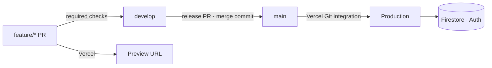

# Deployment

Production is **Vercel**, deploying `src/frontend` from Git. Firebase (Firestore + Auth) holds
all state. There are no containers or servers to run, and the FastAPI backend is not deployed.

## Vercel

| Setting           | Value                                                                                                                                                                                      |
| ----------------- | ------------------------------------------------------------------------------------------------------------------------------------------------------------------------------------------ |
| Root directory    | `src/frontend`                                                                                                                                                                             |
| Framework         | Next.js (build `npm run build`)                                                                                                                                                            |
| Function timeouts | `src/frontend/vercel.json`: strava/sync and cron/expire 60 s, discover and route-climb 45 s, chat and admin/cache 30 s, others 15 s                                                        |
| Runtime           | Node.js for every route that uses the Admin SDK                                                                                                                                            |
| Env vars          | Project Settings → Environment Variables, per environment. Names and meanings are in `.env.example`; the traps are in [`.claude/CLAUDE.md`](../../.claude/CLAUDE.md#environment-variables) |

Release: merge `develop` → `main` with a **merge commit**. A squash breaks the shared history
and makes the next release conflict.

Each push to `main` then runs [`release.yml`](../../.github/workflows/release.yml): it tags the
commit `vYYYY.MM.DD` (`.2`, `.3` for a second release that day), publishes a GitHub Release with
generated notes, and pushes the backend image to `ghcr.io/oweeboi011/fit-ready-iq-backend` with
that tag and `latest`. Re-running it on a tagged commit reuses the tag. A new package is private
until made public in its GHCR settings.

Cron: `vercel.json` schedules `/api/cron/expire` daily at 19:00 UTC. Vercel → Settings → Cron
Jobs lists it, and **Run** starts it on demand.

Rollback: Vercel → Deployments → last good one → _Promote to Production_, or
`vercel promote <url>`. Deployments are immutable, so a rollback is instant.

## After a deploy

1. `curl -s $URL/api/health`. Expect `healthy`; `degraded` names what is missing.
2. Open `/app`: the map renders and lists load.
3. Sign in, save a place, send a chat message, and connect Strava.
4. `uptime.yml` probes `/api/health` every 15 minutes. It needs the `PRODUCTION_URL` repository
   variable.

## One-time platform setup

| What                                      | Where                                                                | Why                                                                                                               |
| ----------------------------------------- | -------------------------------------------------------------------- | ----------------------------------------------------------------------------------------------------------------- |
| `CRON_SECRET` + indexes for expiry sweep  | [runbooks/expiry-sweep.md](runbooks/expiry-sweep.md)                 | Otherwise five collections grow forever                                                                           |
| Deploy rules and indexes                  | `firebase deploy --only firestore` (root `firebase.json`)            | The rules are the browser's only guard                                                                            |
| `GOOGLE_WEATHER_API_KEY` (optional)       | A server key with **no** referrer restriction; no browser key exists | Server-to-server calls send no referer. OpenWeather is the fallback                                               |
| `RATE_LIMIT_SALT`                         | Vercel env                                                           | Without it `/api/health` reports `rate_limiting` degraded                                                         |
| CSP enforcement                           | [runbooks/csp-enforcement.md](runbooks/csp-enforcement.md)           | Promote the policy from Report-Only                                                                               |
| Branch protection on `main` and `develop` | GitHub → Settings → Branches                                         | Required: `Frontend Quality`, `Backend Quality`, `Playwright E2E`, `Secret Scan`; 1 review; dismiss stale reviews |
| GitHub secrets                            | Settings → Secrets → Actions                                         | E2E uses real keys (listed in `.claude/CLAUDE.md`)                                                                |
