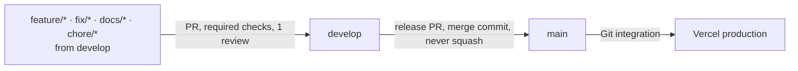

# Development

Setup, the test suites, and the problems people actually hit. For the gates themselves, see
[harness.md](harness.md).

## Setup

```bash
cp .env.example .env.local        # one env file for the whole repo, at the root
cd src/frontend && npm install    # also installs the Husky hooks
npm run dev                       # http://localhost:4790
docker-compose up -d              # optional: Firestore 8080, Auth 9099, UI 4000
```

Backend (optional, not deployed): `cd src/backend && poetry install && poetry run uvicorn
src.main:app --reload --port 8000`. On Windows without `poetry` on `PATH`, use
`python -m poetry`. `CORS_ORIGINS` must be a JSON array.

`envCoverage.test.ts` fails the build if `.env.example` and the code disagree. The variables
are documented inline in `.env.example`; the ones that trip people up are in
[`.claude/CLAUDE.md`](../../.claude/CLAUDE.md#environment-variables).

## Workflow



Commits use Conventional Commits with a lower-case subject of at most 100 characters
(`feat(weather): add forecast window`). Use the PR template, and update any doc your change
makes untrue in the same PR.

## Tests

| Kind | Where | Run | Runs in CI |
|---|---|---|---|
| Unit | `src/frontend/src/**/*.test.ts` (next to the code) · `src/backend/tests/unit` | `npm run test:unit` · `poetry run pytest` | Every PR |
| Component | `src/frontend/src/components/**/*.test.tsx` (next to the code) | `npm run test:unit` | Every PR |
| Integration | `src/frontend/tests/integration/api` (route handlers) · `src/backend/tests/integration` | `npm run test:unit` · `poetry run pytest` | Every PR |
| Integration (rules) | `src/frontend/tests/integration/firestore-rules` | `npm run test:rules` (needs Java) | Every PR |
| Architecture | `src/backend/tests/unit/test_architecture.py` · depcruise | `pytest` · `npm run lint:deps` | Every PR |
| E2E | `src/frontend/tests/e2e` (Playwright, Chromium) | `npm run test:e2e` | Every PR (skipped for forks and Dependabot) |
| Mutation | Stryker on `src/lib` (`stryker.config.json`) | `npm run test:mutation` | PRs that touch `src/lib` |
| Performance | `src/frontend/tests/performance` (autocannon) · `src/backend/tests/performance` (locust) | `npm run test:load` · `poetry run locust -f tests/performance/locustfile.py` | Manual |

Conventions:

- **Unit and component tests sit beside the code they test.** Cross-cutting suites live under
  `tests/`.
- **Coverage is an allowlist** in `vitest.config.ts`. A module that gains a test is added to
  it; a blanket glob would fail the 85% gate.
- **Test behaviour through the public interface.** Mock at system boundaries (`fetch`,
  Firebase), not your own modules.
- **`useSavedPlaces.test.ts` is the only test allowed a top-level `await import()`.** Stryker
  mutates string literals in dynamic imports, which breaks Vite's resolver.

## Troubleshooting

| Symptom | Cause → fix |
|---|---|
| `No module named uvicorn` | Run it through `poetry run`; the dependencies live in the Poetry venv |
| `poetry` not recognised (Windows) | Add `%APPDATA%\Python\Python312\Scripts` to `PATH`, or use `python -m poetry` |
| `poetry lock` fails with `CERTIFICATE_VERIFY_FAILED` | A TLS-inspecting proxy. Export the Windows root store to a PEM and set `REQUESTS_CA_BUNDLE` for the command |
| Backend dies on `ValidationError` at start | `FIREBASE_PROJECT_ID` unset, or `CORS_ORIGINS` not a JSON array |
| `NEXT_PUBLIC_*` undefined in the browser | The root `.env.local` must load before compilation. `next.config.js` does this; restart `npm run dev` after editing it |
| Map blank with `RefererNotAllowedMapError` / `ApiNotActivatedMapError` | Add `localhost:4790` to the browser key's referrers, or enable the API ([Google APIs table](../../.claude/CLAUDE.md#google-apis-actually-required)) |
| Directions or weather: "Requests from referer &lt;empty&gt; are blocked" | Those calls are server-to-server. Set `GOOGLE_ROUTES_API_KEY` / `GOOGLE_WEATHER_API_KEY` to keys with **no** referrer restriction |
| E2E fails with `BillingNotEnabledMapError` | Billing is off on the CI key's GCP project |
| Chat 503 | `GEMINI_API_KEY` unset. A 502 means Gemini refused or hit quota |
| Sign-in popup closes, `auth/unauthorized-domain` | Add the domain under Firebase Auth → Authorized domains |
| `auth/operation-not-allowed` | Enable the provider under Firebase Auth → Sign-in method |
| Saved places do nothing | Signed out, or the deployed rules lack the `saved_places` `match` block (rules do not cascade) |
| Strava connect loops | The callback domain in Strava app settings must match. `NEXT_PUBLIC_STRAVA_CLIENT_ID` and `STRAVA_CLIENT_ID` must both be set |
| Strava routes 409 | Not connected, or Strava revoked the grant. Reconnect |
| Pre-commit "no src/backend/.venv — skipping ruff" | Run `poetry install` in `src/backend` (in-project venv). CI runs ruff regardless |
| A stale build or types error after pulling | Delete `src/frontend/.next` and rebuild |
