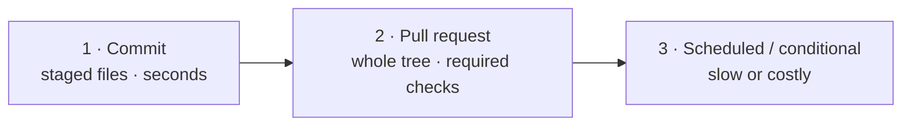

# Quality harness

The minimum set of checks that keeps this codebase honest. A check belongs here if a machine
can decide it. Anything that needs judgment goes on the [review checklist](#what-stays-human)
instead. Why it is shaped this way: [ADR-0002](../adr/0002-mechanical-code-quality-gates.md)
(gate over review) and [ADR-0006](../adr/0006-minimum-viable-harness.md) (this set and no more).

## Three stages, nothing else



| Stage            | Where                                                                                          | What runs                                                                                                                                                                                      | Blocks                                                                                             |
| ---------------- | ---------------------------------------------------------------------------------------------- | ---------------------------------------------------------------------------------------------------------------------------------------------------------------------------------------------- | -------------------------------------------------------------------------------------------------- |
| **1. Commit**    | `.husky/pre-commit`, `.husky/commit-msg`                                                       | secretlint on every staged file → ESLint `--fix` + Prettier (`src/frontend` only; root docs are caught by `format:check` in CI) → ruff `check` + `format --check` (staged Python) → commitlint | The commit                                                                                         |
| **2. PR**        | `ci.yml`, `security.yml`, `e2e.yml`                                                            | Frontend `npm run quality` + tests + build · Backend ruff, mypy, import-linter, vulture, pytest · gitleaks, `npm audit`, `pip-audit`, CodeQL · Playwright · Firestore rules                    | The merge (`Frontend Quality`, `Backend Quality`, `Playwright E2E` and `Secret Scan` are required) |
| **3. Scheduled** | `mutation.yml` (when `src/lib/` changes), `security.yml` (weekly), `uptime.yml` (every 15 min) | Stryker · full security re-scan · `/api/health` probe · Semgrep (advisory) · load tests (manual)                                                                                               | Nothing; they report                                                                               |

A stage-1 failure is cheap to fix and a stage-3 finding is expensive, so every check runs at
the earliest stage it can afford. CI repeats everything from stage 1, so a skipped hook
(`--no-verify`, or no backend venv) is still caught before merge.

## What each concern is held by

**High priority, gated:**

| Concern                                      | Frontend (`src/frontend`)                                                               | Backend (`src/backend`)                                                         |
| -------------------------------------------- | --------------------------------------------------------------------------------------- | ------------------------------------------------------------------------------- |
| Secrets                                      | secretlint (stage 1) · gitleaks, full history (stage 2)                                 | same                                                                            |
| Vulnerable packages                          | `npm audit --audit-level=high` · Dependabot · `overrides` in `package.json`             | `pip-audit` (OSV) · Dependabot                                                  |
| Bad patterns                                 | CodeQL · Semgrep (advisory) · ESLint `no-alert`                                         | CodeQL · ruff `S` (bandit), `B` (bugbear)                                       |
| Banned APIs                                  | `console` in server code (use `logger.ts`) · non-`NEXT_PUBLIC_` env read in client code | `os.environ` / `os.getenv` outside `config/` · `requests` (use httpx) · `print` |
| Reusable components ignored                  | `aria-modal` outside `Modal.tsx` · `window.confirm` (use `ConfirmDialog`)               | —                                                                               |
| Dead code, logic, models                     | **knip** (files, exports, deps, types) · depcruise `no-orphans`                         | **vulture** (80% confidence) · ruff `F401`/`F841`/`ERA`                         |
| Circular dependencies                        | depcruise `no-circular`                                                                 | import-linter (layers forbid cycles between them)                               |
| Forbidden imports                            | depcruise `server-only-modules`, `lib-is-innermost`, `components-do-not-import-pages`   | import-linter: domain imports no fastapi / firebase_admin / httpx / outer layer |
| Clean Architecture / SOLID (mechanical part) | The layer rules above                                                                   | import-linter `layers`: presentation → application → domain                     |
| Cyclomatic complexity                        | ESLint `complexity` 15 · `max-depth` 4 · `max-params` 5                                 | ruff `C90` 15                                                                   |
| Size                                         | `max-lines` 500 · `max-lines-per-function` 150                                          | —                                                                               |
| Duplication                                  | jscpd ≤ 3% of tokens (TS, TSX **and** Python, one config)                               | ↑                                                                               |
| Tests mean something                         | Coverage ≥ 85% (allowlist in `vitest.config.ts`) · Stryker break 70%                    | `--cov-fail-under=85`                                                           |
| Docs stay true                               | `lint:docs`: broken relative links, empty files, `docs/` outside the taxonomy           | ↑                                                                               |

**Low priority, gated but cheap:** ESLint and ruff lint, `tsc --noEmit` and mypy, Prettier and
`ruff format`, the `@typescript-eslint/naming-convention` rule and ruff `N`, and commitlint
(Conventional Commits, lower-case subject).

## Running it

```bash
# src/frontend
npm run quality      # lint · format:check · type-check · lint:deps · lint:dup · lint:dead · lint:docs
npm run test:unit    # unit + component + API integration, with coverage

# src/backend  (python -m poetry ... if poetry is not on PATH)
poetry run ruff check . && poetry run ruff format --check .
poetry run mypy src/ && poetry run lint-imports && poetry run vulture
poetry run pytest
```

Measured 2026-10-06 on a laptop: `quality` ~16 s (ESLint 8, tsc 3, the rest ≤ 2 each),
`test:unit` ~9 s, backend gates + pytest ~21 s. A step that doubles these needs a reason.

| Config                                 | Holds                                                            |
| -------------------------------------- | ---------------------------------------------------------------- |
| `src/frontend/eslint.config.mjs`       | Ceilings, banned APIs, naming, credential split, legacy baseline |
| `src/frontend/.dependency-cruiser.cjs` | Layers, cycles, server-only modules                              |
| `src/frontend/knip.jsonc`              | Dead-code entry points                                           |
| `src/frontend/.jscpd.json`             | Duplication, both languages                                      |
| `src/frontend/.secretlintrc.json`      | Pre-commit secret rules                                          |
| `src/backend/pyproject.toml`           | ruff rules, import-linter contracts, vulture, coverage floor     |

## The baseline only shrinks

The ceilings were set for code going forward, not to fit the code that already existed.
Files that were over the line when a gate landed are named in `LEGACY_OVERSIZED` and
`LEGACY_COMPLEX` in `eslint.config.mjs`, each with its measurement. **Never add to these
lists.** A change that pushes a file over a ceiling gets split instead.

Accepted findings, as of 2026-10-05:

- jscpd: two clones under the threshold, in `coros/client.py` ↔ `garmin/client.py` and in
  `MapArea.tsx` ↔ `map/MapNavDock.tsx`.
- ESLint: 30 `react-hooks/set-state-in-effect` warnings, demoted to warnings at the Next 16
  upgrade.
- Semgrep: the 30 findings on `main` were triaged 2026-10-06 (actions pinned to SHAs,
  Dependabot cooldown; the README secret is already gone). Still advisory until a CI run on
  this tree comes back clean; then drop `continue-on-error` and make it required.
- CodeQL `js/clear-text-storage-of-sensitive-data` (`useUserLocation.ts`, `activityTypes.ts`):
  device-local location and activities are a feature, cleared on sign-out
  (`personalStorage.ts`). Dismiss as "won't fix" in GitHub, not in code.
- CodeQL `js/incomplete-url-substring-sanitization` may flag `mentionsMapsApi` in
  `MapView.tsx`: it reads error text to pick an error message and trusts nothing. False positive.
- vulture reports unused methods and classes only at 60% confidence, because it cannot see
  FastAPI routing or pydantic. Those are checked in review, not gated.

## What stays human

These checks need judgment. Encoding them as heuristics produces rules people learn to
suppress.

- **Single responsibility.** Does the module have one reason to change?
- **Open/closed, dependency inversion.** Does new behaviour arrive as a new adapter behind an
  existing port, or as another `if` in a core module? In the backend, does a use case depend on
  a `domain/interfaces` port rather than an infrastructure class?
- **Interface segregation, Liskov.** Would a caller have to reach past this interface, or
  stub methods it never calls?
- **Is this duplication wrong?** jscpd flags copies. Two things that change for different
  reasons should stay apart.
- **Does the name say what it does?** Lint checks casing; only a reviewer can tell that
  `handleData` names nothing.
- **Do the tests assert behaviour?** Stryker gives a number; a person decides whether the
  surviving mutants matter.
- **Polyline order** is `[lng, lat]`. No tool catches a swap.
- **Docs.** A change to branch flow, layout, data model or a public route updates its doc in
  the same PR ([ADR-0005](../adr/0005-documentation-governance-harnessing.md)).

## Adding a gate

1. Make sure it is deterministic. If the failing case needs the word "usually", it belongs on
   the checklist.
2. Run it on the current tree first. Fix what it finds, or baseline it with a date.
3. Add it to the `quality` script (or `pyproject.toml`) so CI and local runs pick it up from one place, then add a CI step.
4. Add a row to the table above. If it changes how people work, record an ADR.
