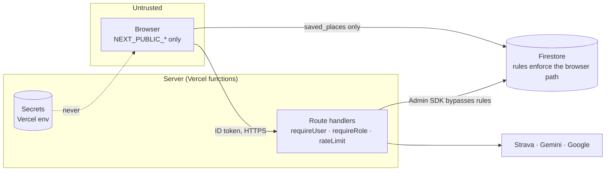
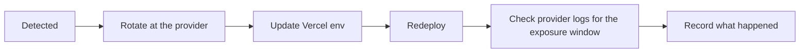

# Security

How the product protects credentials and user data, and what it knows it does not yet do.
Vulnerability reporting is in the root [`SECURITY.md`](../../SECURITY.md). The mechanical
checks are in [harness.md](harness.md).

## Trust boundaries

The Admin SDK bypasses Firestore rules, so **route handlers are the security boundary for
everything except `saved_places`**. Every route takes identity from a verified token, never
from a request body or query string.

## Controls

| Control          | Implementation                                                                                                                                                                               | Enforced by                                                                                                                         |
| ---------------- | -------------------------------------------------------------------------------------------------------------------------------------------------------------------------------------------- | ----------------------------------------------------------------------------------------------------------------------------------- |
| Credential split | Only `NEXT_PUBLIC_*` reaches the browser. Secrets live in server-only modules                                                                                                                | ESLint env selector · depcruise `server-only-modules` · `envCoverage.test.ts` (fails if a secret-looking name gains `NEXT_PUBLIC_`) |
| Identity         | `requireUser` / `optionalUser` verify the ID token with revocation checks                                                                                                                    | `serverAuth.test.ts` · review                                                                                                       |
| Admin            | `viewer` and `admin` roles on the `fri_role` claim. `ADMIN_EMAILS` (server-only) always outranks the claim, so a bad claim can't lock out the last admin. Requires `email_verified`          | `adminAuth.test.ts` · Stryker                                                                                                       |
| Strava tokens    | Held in `strava_tokens/{uid}`, never sent to the browser. OAuth uses a one-shot `state` nonce                                                                                                | rules deny all client access · tests                                                                                                |
| Firestore rules  | Owner-scoped. Ownership is fixed at create (`updatesOwnDoc`). **Rules do not cascade**, so each subcollection needs its own `match`                                                          | `npm run test:rules` (emulator)                                                                                                     |
| Rate limits      | Every route has a budget in `rateLimitRules.ts`, keyed by verified uid or else IP. Fails **open** if Firestore is down (logged at `error`) so a degraded dependency doesn't become an outage | `rateLimitCoverage.test.ts`                                                                                                         |
| Headers          | HSTS, `X-Frame-Options`, `frame-ancestors`, `nosniff`, `Referrer-Policy`, `Permissions-Policy`. The CSP resource directives are Report-Only until `CSP_ENFORCE_RESOURCES=true`               | `next.config.js` · [runbooks/csp-enforcement.md](runbooks/csp-enforcement.md)                                                       |
| Logs             | JSON through `logger.ts`, redacting token, secret, key, password, authorization and cookie fields. Upstream bodies go through `upstreamSnippet()`                                            | ESLint `no-console` in server code                                                                                                  |
| Audit            | Append-only `audit_logs` for admin reads, purges, exports, erasures and _denied_ admin attempts. 730-day TTL                                                                                 | `auditLog.test.ts`                                                                                                                  |
| Data rights      | `GET /api/account/export` (Art. 15) and `POST /api/account/delete` (Art. 17), both walking `userDataFootprint.ts`. The audit record survives erasure as proof (Art. 17(3)(b))                | tests · review                                                                                                                      |
| Supply chain     | `npm audit` high, `pip-audit`, Dependabot, `overrides` for transitive fixes, gitleaks, secretlint, CodeQL                                                                                    | `security.yml` · pre-commit                                                                                                         |

## Known gaps

| Gap                                                | Risk   | Status                                                                                                                                                                                                                                                    |
| -------------------------------------------------- | ------ | --------------------------------------------------------------------------------------------------------------------------------------------------------------------------------------------------------------------------------------------------------- |
| CSP resource directives Report-Only by default     | Medium | Ready to flip. Enable on a preview, exercise the map, sign-in popups, radar and photos, then production                                                                                                                                                   |
| `script-src` needs `unsafe-inline` / `unsafe-eval` | Medium | Next hydration and the Maps SDK need it. Removing it needs per-request nonces                                                                                                                                                                             |
| TTL policies not yet configured                    | Medium | `rate_limits`, `chat_sessions` (+ `messages`, collection-group) and `audit_logs` grow without bound until they are. [runbooks/firestore-ttl.md](runbooks/firestore-ttl.md)                                                                                |
| No multi-tenancy or enterprise SSO                 | Medium | Needs Google Cloud Identity Platform, a tenant per customer, and an `org_id` migration across collections, rules and indexes. Roles already ride on custom claims, so `requireRole` is the one place that changes. **Do not sell SSO until this is done** |
| `/api/chat` is unauthenticated                     | Low    | A product choice: rate-limited (20/h) and input-bounded. Revisit with the paywall                                                                                                                                                                         |
| Chat transcripts from before the `user_id` stamp   | Low    | Cannot be attributed, so erasure cannot reach them. They drain via the 90-day TTL                                                                                                                                                                         |
| Semgrep advisory                                   | Low    | Triage the pre-existing findings, then make it required                                                                                                                                                                                                   |

## If a secret leaks

Rewriting git history does not un-leak a credential, so rotate first. Add a reviewed false
positive to `.gitleaksignore` rather than weakening the scanner.

## Quarterly review

- Rotate keys. Check the browser key's referrer and API restrictions.
- Diff the deployed Firestore rules against `firestore.rules`. Confirm every browser-touched
  subcollection has a `match`.
- Grep route handlers for any uid not taken from `requireUser`.
- Check that the `ADMIN_EMAILS` and `fri_role` holders are still the right people.
- Re-read this table and close or re-rate each gap.
