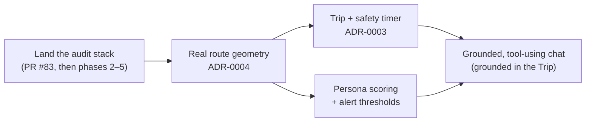
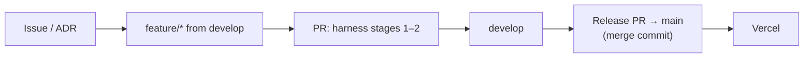

# Solution plan

**What the product should do, and how it gets delivered.** What the product _is_ today lives in
[`docs/guides`](../guides/architecture.md). Why it was designed this way lives in
[`docs/adr`](../adr/README.md). Item-level status is kept next to the code in
`src/frontend/src/lib/roadmap.ts`, which drives the in-app roadmap, so this page names
outcomes and order rather than restating every ticket.

Revised 2026-10-05. Every earlier revision drifted from the code within weeks, so this one is
deliberately short.

## Problem

Outdoor athletes plan across AllTrails, Komoot, Strava and a weather app, and still have to
judge for themselves whether they are fit enough and when to go. Fit-Ready-IQ answers that in
one place: **this route, this athlete, this weather window.**

| Persona       | Decides on                               | Needs that set them apart                          |
| ------------- | ---------------------------------------- | -------------------------------------------------- |
| Mountaineer   | Summit, ascent, exposure, weather window | Acclimatisation, lightning and whiteout stop rules |
| Hiker         | Distance, ascent, campsites, water       | Campsite discovery, trail surface                  |
| Trail runner  | Vert per km, technicality, finish time   | Finish-time estimate                               |
| Ultra cyclist | Climbing, gradient, wind, resupply       | Gradient analysis, headwind forecast               |

Every persona sees the same product today; persona tailoring is planned.

## What it must do

These rules hold across every feature, and a feature that cannot meet them does not ship:

1. **No number the data does not support.** Unknown is a state, not a zero. No sample data.
2. **Readiness is gated by the limiting factor**, never averaged.
3. **Failures are sayable**, with a retry.
4. **User data is exportable and erasable**, through one footprint list.
5. **Every route is metered and every privileged act audited.**

| Capability                                                      | Status                           | Next                                                                     |
| --------------------------------------------------------------- | -------------------------------- | ------------------------------------------------------------------------ |
| Discover routes, peaks, campsites near you                      | Done                             | Real route geometry (ADR-0004)                                           |
| Elevation, difficulty (NPS formula), unknown band               | Done                             | Along-route elevation once geometry lands                                |
| Live weather, alerts, **weather window** for a route's duration | Done                             | Persona alert thresholds                                                 |
| Readiness score and "routes you're ready for"                   | Done                             | Persona weighting, after ADR-0004                                        |
| Strava sync (server-held tokens), GPX and Apple Health import   | Done                             | Garmin / COROS direct connect                                            |
| Planner with routing, GPX export, saved plans                   | Partial                          | Plans synced to the account                                              |
| Lifetime ledger and personal bests                              | Done                             | —                                                                        |
| Chat assistant                                                  | Partial (no tools, no grounding) | Tool use: save a route, analyse a route, read the weather window         |
| Trip, check-in and server-side safety timer (ADR-0003)          | Pending                          | Needs a notification channel decision first                              |
| Paywall enforcement (`plans.ts` entitlements)                   | Pending                          | `hasEntitlement()` is not called anywhere yet                            |
| Installable / offline for the current Trip                      | Partial                          | Offline scope is the Trip only; map tiles are excluded by Google's terms |

## Order of work

- **Geometry before Trip.** A Trip references a Route. Building it on pin-based metrics would
  carry the fabricated-numbers problem into the new feature.
- **The backend stays undeployed** until a use case needs a second runtime. Trip runs in route
  handlers plus a scheduled function.
- **Field-level schemas are written with the first code that produces them**, not ahead of it.
- **Billing after Trip.** Pro is sold on readiness, which is scored on pin metrics until
  ADR-0004 lands; wiring `hasEntitlement()` before then charges for the problem ADR-0004 fixes.

Open product questions (owner): is the Guide tier near-term or withdrawn until it exists? Does
the free tier keep readiness? How close must a track pass a summit before a peak is suggested?

## How it is delivered

| Change                                | Needs                                                                         |
| ------------------------------------- | ----------------------------------------------------------------------------- |
| Bug fix, refactor                     | PR + required checks + 1 review                                               |
| Feature                               | The above, plus a `roadmap.ts` entry and a guide updated if behaviour changed |
| Data model, external service, process | The above, plus an ADR                                                        |
| Security-relevant                     | The above, plus [security.md](../guides/security.md) updated                  |

**Definition of done:** the harness is green ([harness.md](../guides/harness.md)), docs touched
by the change are updated in the same PR, and a new user-scoped collection is in
`userDataFootprint.ts`, `firestore.rules` and the rules tests.

## Risks

| Risk                                                         | Mitigation                                                                  |
| ------------------------------------------------------------ | --------------------------------------------------------------------------- |
| Fixes sit on unmerged branches; CI only runs on PRs          | Land work in order through PRs. Don't stack more on an unreviewed branch    |
| E2E (a required check) blocked by billing on the CI Maps key | Owner enables billing on that GCP project                                   |
| Production unmonitored                                       | Set `PRODUCTION_URL` and `RATE_LIMIT_SALT`; `uptime.yml` then alerts        |
| Google Maps / Places spend                                   | Two-tier places cache, batching, rate limits, billing alerts                |
| ADR-0003/0004 rewrite regresses discovery                    | Land geometry alongside the pin path, not as a replacement in one PR        |
| Docs drift                                                   | `lint:docs` gate, same-PR rule (ADR-0005), three-folder taxonomy (ADR-0007) |
| `/privacy` lacks legal review and a contact address          | Owner action before launch                                                  |

## Success measures

Measured at each release, not estimated:

| Measure                                | Target  |
| -------------------------------------- | ------- |
| Time to first map render (p75, mobile) | < 2 s   |
| Places API calls per session           | < 25    |
| Chat p95 latency                       | < 1.5 s |
| Lighthouse performance, `/`            | > 90    |
| Mutation score, `src/lib`              | ≥ 80%   |
| `npm audit` high/critical              | 0       |

## Audits

Point-in-time assessments of reality against this plan. Each lists findings with their status.

- [2026-09-28 solution audit](audits/2026-09-28-solution-audit.md): security, privacy,
  delivery.
