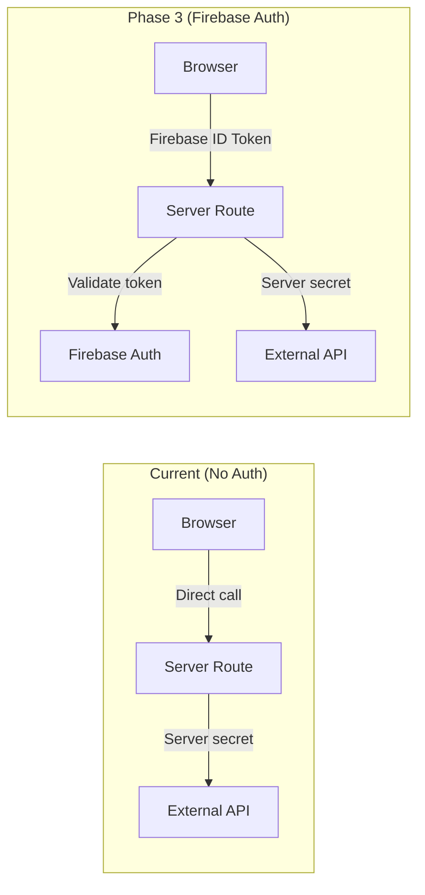
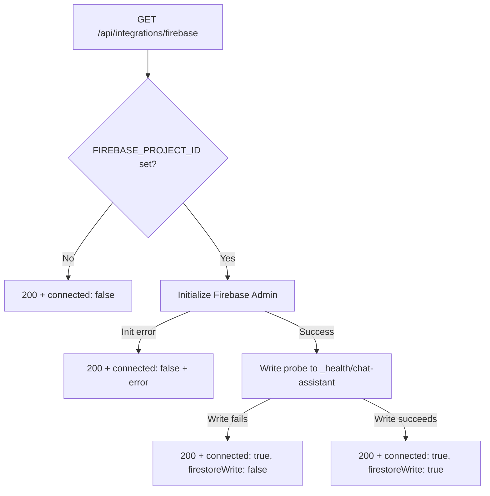
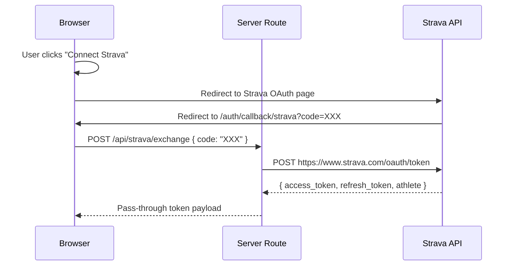
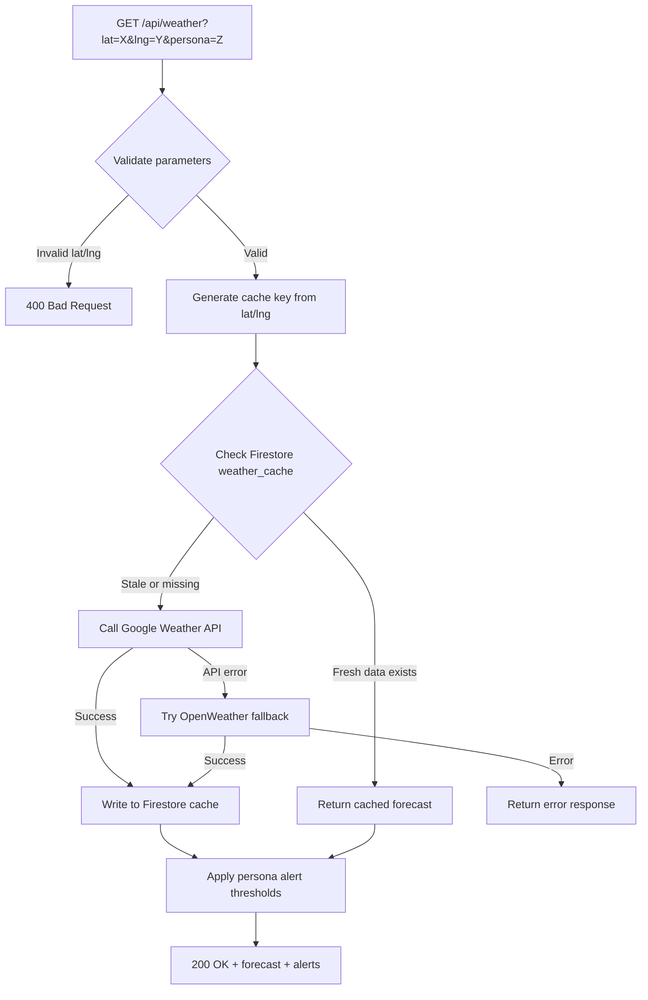
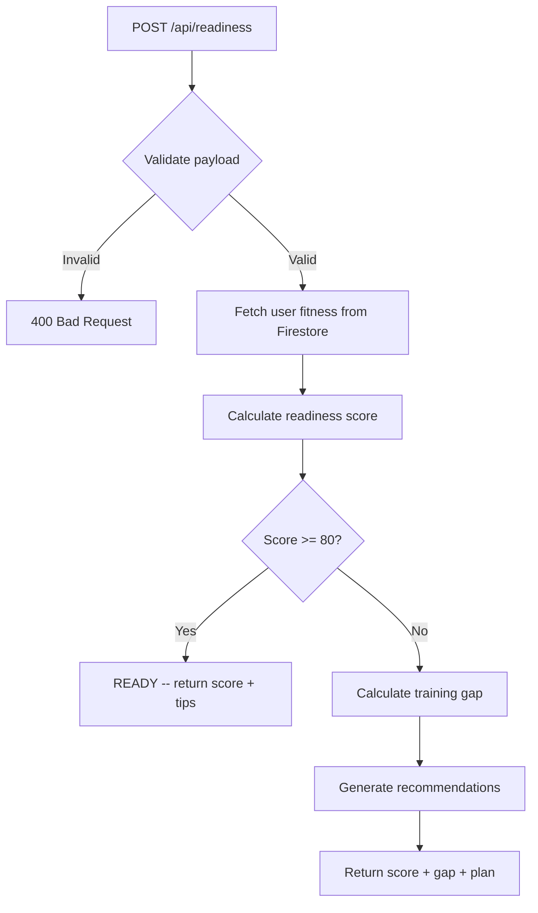
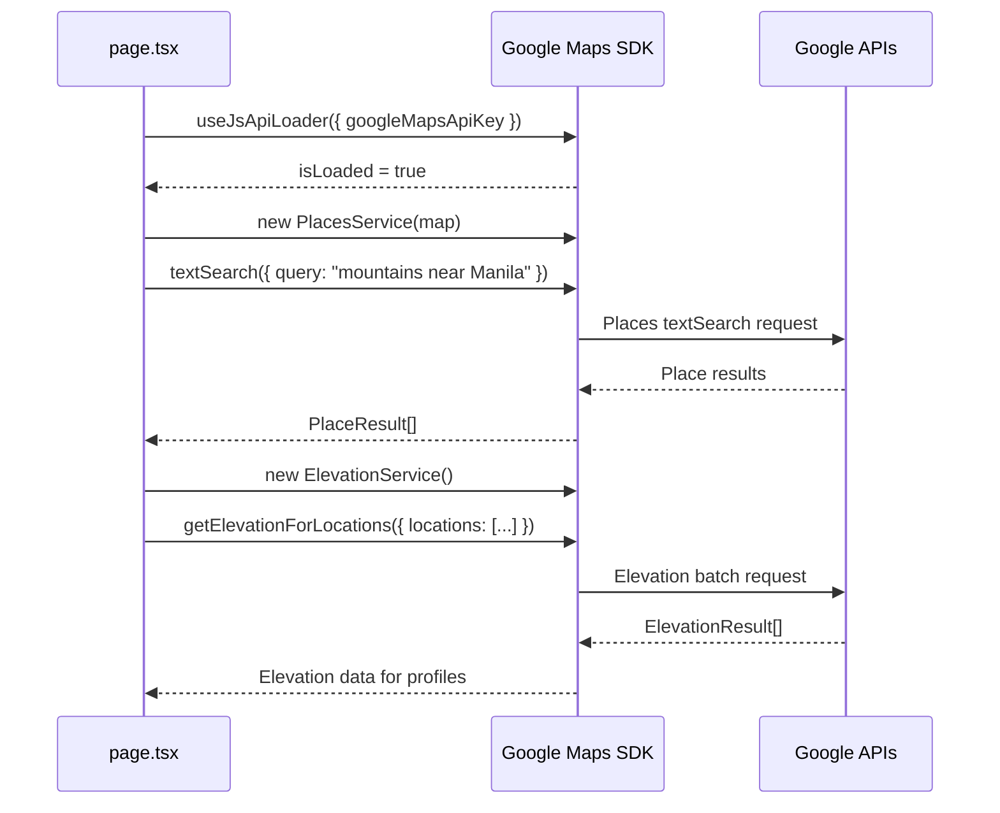
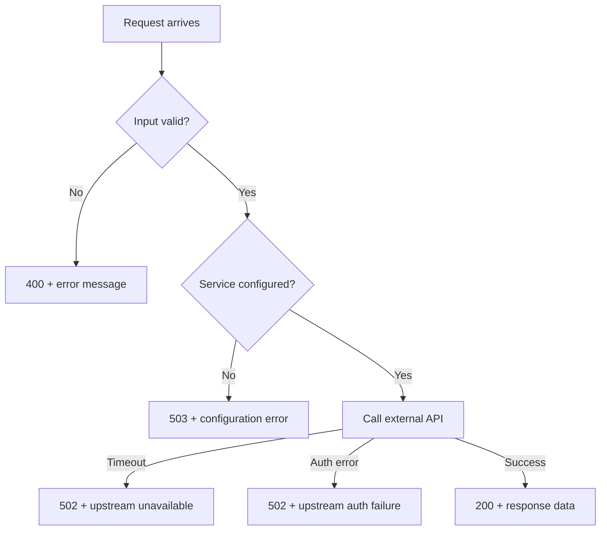
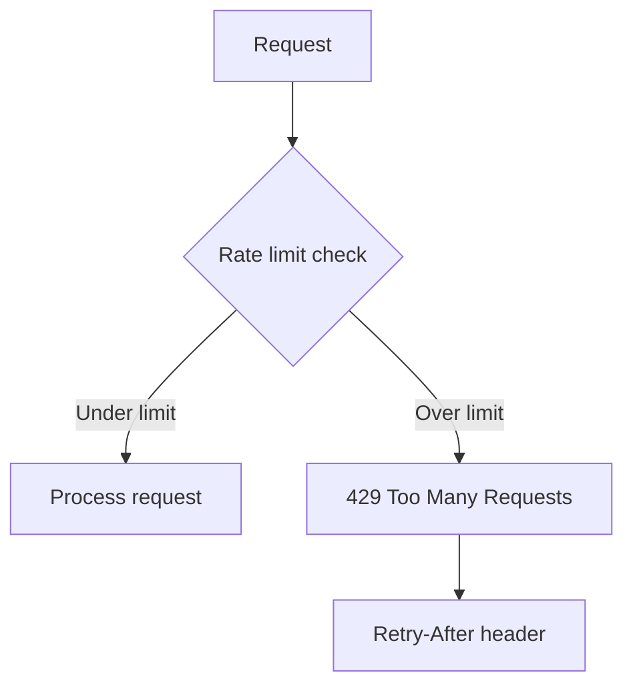

# Fit-Ready-IQ API Reference

## 1. Overview

This document provides a complete reference for all API endpoints in the Fit-Ready-IQ platform. The API surface consists of Next.js server routes (deployed as Vercel serverless functions) that proxy external service calls and manage data persistence. These routes keep secrets server-side, validate inputs, and return structured responses.

All server routes:
- Run on **Node.js runtime** (not Edge) to support Firebase Admin SDK
- Accept and return **JSON** payloads
- Validate request payloads before processing
- Return structured error responses with appropriate HTTP status codes
- Handle external API failures gracefully with fallback responses

### Base URLs

| Environment | Base URL |
| --- | --- |
| Local Development | `http://localhost:4790` |
| Vercel Preview | `https://<deployment-id>.vercel.app` |
| Vercel Production | `https://your-custom-domain.com` |

---

## 2. API Architecture

### 2.1 Route Overview

```mermaid
graph TB
    subgraph Client["Client (Browser)"]
        UI["Next.js Frontend"]
    end

    subgraph ServerRoutes["Server Routes (Vercel Functions) - Active"]
        Chat["POST /api/chat<br/>AI Conversation"]
        Weather["GET /api/weather<br/>Live Forecasts"]
        Health["GET /api/health<br/>Aggregate Health Check"]
        PlacesCache["GET /api/places/cache<br/>Grid-based Cache"]
        StravaEx["POST /api/strava/exchange<br/>OAuth Token Exchange"]
        StravaAct["GET /api/strava/activities<br/>Activity Retrieval"]
        StravaSync["GET /api/strava/sync<br/>Admin Sync"]
        AdminCache["GET /api/admin/cache<br/>Cache Management"]
        AdminStrava["GET /api/admin/strava-sync<br/>Sync Status"]
        Firebase["GET /api/integrations/firebase<br/>Firebase Health"]
    end

    subgraph PlannedRoutes["Planned Routes"]
        Readiness["POST /api/readiness<br/>Fitness Scoring (Phase 4)"]
    end

    subgraph External["External Services"]
        Gemini["Gemini 2.5 Flash"]
        GoogleW["Google Weather API"]
        Strava["Strava API"]
        FS["Firebase Firestore"]
    end

    UI --> Chat
    UI --> Weather
    UI --> Health
    UI --> PlacesCache
    UI --> StravaEx
    UI --> StravaAct

    Chat --> Gemini
    Chat --> FS
    Weather --> GoogleW
    Weather --> FS
    Health --> FS
    PlacesCache --> FS
    StravaEx --> Strava
    StravaAct --> Strava
    StravaSync --> Strava
    StravaSync --> FS
    AdminCache --> FS
    AdminStrava --> FS
    Firebase --> FS
    Readiness --> FS
```



### 2.2 Authentication Model

Currently, API routes do not require authentication tokens. Routes that need secrets (Strava, Gemini, Firebase) use server-side environment variables. User authentication via Firebase Auth will be added in Phase 3, at which point routes will validate Firebase ID tokens.



---

## 3. Active Endpoints

### 3.1 POST /api/chat

**Description:** Sends the user's turn to Gemini 2.5 Flash and returns the reply.

**Identity:** optional. A signed-in caller sends `Authorization: Bearer <Firebase ID token>`
(the widget uses `optionallyAuthedFetch`). Rate-limited to 20/hour per verified uid, or per IP
when signed out.

**History is not taken on trust.** For a session the server already holds, the model context is
rebuilt from `chat_sessions/{id}/messages` and only the client's final turn is used; the client
could otherwise write the assistant's side of the conversation. For a new session, the client's
last 20 messages are used (trimmed to start on a user turn).

**Persistence:** signed-in conversations only. The owner is written once, at create; a
`sessionId` that is unknown, malformed or someone else's gets a fresh server-minted id instead.
Signed-out conversations are not stored — there would be no owner to export or erase them for —
and the response then carries no `sessionId`. Stored turns expire after 90 days (TTL).

**Request:**

```http
POST /api/chat
Content-Type: application/json
Authorization: Bearer <Firebase ID token>   (optional)

{
  "sessionId": "8c1f…-uuid",
  "messages": [{ "role": "user", "content": "What gear do I need for Mt. Pulag in December?" }]
}
```

| Field | Type | Required | Description |
| --- | --- | --- | --- |
| `sessionId` | string (UUID) | No | A session this caller owns. Anything else is replaced by a new id. |
| `messages` | array | Yes | 1–200 messages; the **last must be `role: "user"`**. Each at most 8,000 characters. |

**Responses:**

| Status | Body | Condition |
| --- | --- | --- |
| 200 | `{ "message": "…", "sessionId": "…" }` | Signed in |
| 200 | `{ "message": "…" }` | Signed out (nothing stored) |
| 400 | `{ "error": "Invalid request body" \| "Messages array required" \| "Invalid message format" }` | Malformed, or the last turn is not the user's |
| 413 | `{ "error": "Request too large" \| "Too many messages" \| "Message too long" }` | Body over 256 KB, >200 messages, or a message over 8,000 chars |
| 429 | `{ "error": "Too many requests…" }` + `Retry-After` | Budget spent |
| 502 | `{ "error": "AI service unavailable" }` | Gemini refused |
| 503 | `{ "error": "AI assistant is not configured…" }` | `GEMINI_API_KEY` not set |
| 504 | `{ "error": "AI service timed out" }` | Gemini exceeded 20 s |

---

### 3.2 GET /api/integrations/firebase

**Description:** Verifies that the Firebase Admin SDK is properly initialized and can perform write operations to Firestore. Used as a health check endpoint for deployment validation.

**Runtime:** Node.js

**Flow:**



**Request:**

```http
GET /api/integrations/firebase
```

No request body or query parameters required.

**Responses:**

| Status | Body | Condition |
| --- | --- | --- |
| 200 | `{ "connected": true, "provider": "firebase", "gcpProjectId": "...", "firestoreWrite": true }` | Fully operational |
| 200 | `{ "connected": false, "provider": "firebase", "error": "FIREBASE_PROJECT_ID is required" }` | Missing configuration |
| 200 | `{ "connected": true, "provider": "firebase", "firestoreWrite": false, "error": "..." }` | Partial failure |

**Note:** This endpoint always returns 200 to allow monitoring tools to distinguish between "endpoint reachable" and "service healthy."

---

### 3.3 POST /api/strava/exchange

**Description:** Exchanges a Strava OAuth 2.0 authorization code for access and refresh tokens. This is the server-side component of the OAuth flow -- the browser redirects to Strava, Strava redirects back with a code, and this endpoint exchanges the code for tokens.

**Runtime:** Node.js

**Flow:**



**Request:**

```http
POST /api/strava/exchange
Content-Type: application/json

{
  "code": "strava-authorization-code"
}
```

| Field | Type | Required | Description |
| --- | --- | --- | --- |
| `code` | string | Yes | Authorization code from Strava OAuth redirect |

**Responses:**

| Status | Body | Condition |
| --- | --- | --- |
| 200 | Strava token response (access_token, refresh_token, expires_at, athlete) | Successful exchange |
| 400 | `{ "error": "Missing authorization code" }` | No code provided |
| 502 | `{ "error": "Strava token exchange failed" }` | Strava API error |

**Configuration:**
- `STRAVA_CLIENT_ID` -- Required. Strava application client ID.
- `STRAVA_CLIENT_SECRET` -- Required. Strava application client secret.

---

### 3.4 GET /api/strava/activities

**Description:** One page of the caller's Strava activities.

**Identity:** required — `Authorization: Bearer <Firebase ID token>`. The Strava credentials are
held server-side in `strava_tokens/{uid}` (`lib/stravaTokens.ts`) and never reach the browser;
there is no token parameter.

```http
GET /api/strava/activities?page=1
Authorization: Bearer <Firebase ID token>
```

| Status | Body | Condition |
| --- | --- | --- |
| 200 | Array of Strava activity objects | |
| 401 | — | No valid Firebase ID token |
| 409 | `{ "error": "Strava is not connected…" }` | Never connected, or Strava refused our token (it is then forgotten) |
| 502 | `{ "error": "…" }` | Strava failed, or timed out (10 s) |
| 503 | `{ "error": "…" }` | Strava rate-limited us (its 429) |

---

### 3.5 GET /api/weather

**Description:** Returns weather forecast data for a geographic location. Uses Google Weather API as the primary source, with OpenWeather as fallback when the primary source is unavailable. Includes current conditions, hourly/daily forecasts, and persona-specific safety alerts. Results are cached in Firestore with a 60-minute TTL to reduce API costs.

**Runtime:** Node.js

**Flow:**



**Request:**

```http
GET /api/weather?lat=14.5995&lng=120.9842&persona=mountaineer
```

| Parameter | Type | Required | Description |
| --- | --- | --- | --- |
| `lat` | number | Yes | Latitude (-90 to 90) |
| `lng` | number | Yes | Longitude (-180 to 180) |
| `elevation` | number | No | Summit elevation in metres, used to adjust the summary. |
| `hours` | number | No | How long the route takes. Scopes the weather window to the route rather than the location — the same forecast is a window for a two-hour walk and a no-go for an eight-hour summit day. Defaults to a short outing. |
| `persona` | string | No | **Not implemented.** No persona branching exists in the route today; see `docs/wiki/USER-FLOW.md` §2. |

> Two further details in this section are aspirational rather than current: there is no Firestore `weather_cache` (caching is a module-level 30-minute cache in `DetailsModal`, plus an HTTP `max-age=1800`), and alert thresholds are not persona-scoped. Both are Phase 1 targets in the solution plan.

**Response:**

```json
{
  "location": { "lat": 14.5995, "lng": 120.9842 },
  "current": {
    "temperature_c": 22,
    "feels_like_c": 20,
    "humidity_pct": 65,
    "wind_speed_kph": 18,
    "wind_direction": "NW",
    "condition": "Partly Cloudy",
    "visibility_km": 12,
    "uv_index": 6,
    "precipitation_mm": 0
  },
  "hourly": [
    { "time": "2026-06-21T07:00:00Z", "temperature_c": 20, "condition": "Clear", "wind_speed_kph": 12 }
  ],
  "daily": [
    { "date": "2026-06-21", "high_c": 28, "low_c": 18, "condition": "Partly Cloudy", "precipitation_chance_pct": 20 }
  ],
  "alerts": [
    { "level": "caution", "type": "wind", "message": "Wind 18 kph -- exposed ridgeline risk for mountaineers" }
  ],
  "window": {
    "status": "clear",
    "start": "2026-06-22T05:00:00Z",
    "end": "2026-06-22T13:00:00Z",
    "hours": 9,
    "worst": null,
    "hazards": [],
    "summary": "9 clear hours in the forecast."
  },
  "sunrise": "05:42",
  "sunset": "18:15",
  "cached_at": "2026-06-21T06:00:00Z",
  "ttl_minutes": 60
}
```

**`window` — when to go** (`src/frontend/src/lib/weatherWindow.ts`)

The soonest span long enough for the route, which is the question ADR-0004 points out current conditions cannot answer. Computed from the same hourly fetch the alerts use, so it costs no extra call.

| `status` | Meaning |
| --- | --- |
| `clear` | A span of `hours` with no hazard at all. `start`/`end` set. |
| `marginal` | Long enough, but carries `watch`-level hazards. Named in `hazards`. |
| `none` | No span long enough. `start`/`end` are `null`; `summary` says whether the forecast is entirely blocked or its good stretches are merely too short. |
| `unknown` | No forecast, or one too short to cover the route. Never an invented span. |

A `warning`-severity hour is disqualifying and never appears inside a window — this is output someone might use to decide whether to walk into a storm, so it errs toward saying no.

**Persona-Specific Alert Thresholds** (target state — not implemented, see the note above)**:**

| Condition | Mountaineer | Hiker | Trail Runner | Cyclist |
| --- | --- | --- | --- | --- |
| Wind (km/h) | >40 warn | >50 warn | >30 warn | >25 warn |
| Rain (mm/h) | >5 warn | >10 warn | >8 warn | >5 warn |
| Temp low (C) | <-5 warn | <0 warn | <-3 warn | <2 warn |
| Temp high (C) | >35 warn | >35 warn | >30 warn | >38 warn |
| Visibility (km) | <1 STOP | <2 warn | <2 warn | <3 warn |
| Lightning | STOP | STOP | STOP | STOP |
| UV Index | >8 warn | >8 warn | >8 warn | >8 warn |

**Configuration:**
- `GOOGLE_WEATHER_API_KEY` -- Primary weather source.
- `OPENWEATHER_API_KEY` -- Fallback weather source. Graceful degradation if both are missing.

---

### 3.6 GET /api/health

**Description:** Aggregates connectivity and configuration checks for all six integrated services in a single call. Designed for post-deployment validation, monitoring dashboards, and uptime checks. The endpoint always returns a response body regardless of service health; the HTTP status code indicates overall system health.

**Runtime:** Node.js

**Request:**

```http
GET /api/health
```

No parameters required.

**Response:**

```json
{
  "status": "healthy",
  "timestamp": "2026-06-27T10:00:00Z",
  "services": {
    "maps":           { "ok": true,  "message": "API key present" },
    "firebase_client":{ "ok": true,  "message": "Project: fit-ready-iq" },
    "firebase_admin": { "ok": true,  "message": "Firestore write OK (project: fit-ready-iq)" },
    "gemini":         { "ok": true,  "message": "API key present and valid format" },
    "weather":        { "ok": true,  "message": "OpenWeather API reachable" },
    "strava":         { "ok": true,  "message": "Client ID: 260217" }
  }
}
```

| Status Value | Meaning | HTTP Code |
| --- | --- | --- |
| `healthy` | All 6 services green | 200 |
| `degraded` | 1-2 services failing (non-critical features affected) | 200 |
| `unhealthy` | 3+ services failing | 503 |

**Configuration:** Checks for the presence of `NEXT_PUBLIC_GOOGLE_MAPS_API_KEY`, all `NEXT_PUBLIC_FIREBASE_*` vars, Firebase Admin credentials, `GEMINI_API_KEY`, `GOOGLE_WEATHER_API_KEY` or `OPENWEATHER_API_KEY`, and `STRAVA_CLIENT_ID`/`STRAVA_CLIENT_SECRET`.

---

### 3.7 GET /api/places/cache

**Description:** Returns cached Google Places results for a geographic grid cell. Coordinates are rounded to the nearest 0.5 degree boundary so that nearby users share cached results. Cache TTL is 24 hours. On a cache miss, fetches from Google Places and writes the result to Firestore.

**Runtime:** Node.js

**Request:**

```http
GET /api/places/cache?lat=14.5995&lng=120.9842&type=mountain
```

| Parameter | Type | Required | Description |
| --- | --- | --- | --- |
| `lat` | number | Yes | Latitude, rounded to 0.5° grid cell internally |
| `lng` | number | Yes | Longitude, rounded to 0.5° grid cell internally |
| `type` | string | No | Place type filter (e.g., `mountain`, `trail`, `campsite`) |

**Responses:**

| Status | Condition |
| --- | --- |
| 200 | Cached or freshly fetched place results |
| 400 | Missing or invalid `lat`/`lng` parameters |
| 502 | Upstream Google Places API error |

**Configuration:**
- `NEXT_PUBLIC_GOOGLE_MAPS_API_KEY` -- Used server-side for Places API calls.
- Firebase Admin credentials -- Required for Firestore cache reads/writes.

---

### 3.8 /api/admin/cache

**Identity:** `requireRole` — `viewer` for GET, `admin` for DELETE. Every denial is audited.

- `GET` — cache entries with freshness.
- `DELETE ?gridKey=<key>` — deletes one entry.
- `DELETE ?all=true` with body `{"confirm":"PURGE"}` — deletes every entry (batches of 400).
- Anything else — including an empty `gridKey`, which used to fall through to a full purge — is a 400.

Every purge, successful or failed, is written to `audit_logs`.

---

### 3.9 GET /api/admin/strava-sync

**Identity:** `requireRole(…, 'viewer')`. Returns each user's `strava_sync` manifest:
`last_synced_at`, `total_activities` (the count stored, not the last run's) and up to five errors.

---

### 3.10 /api/strava/connection

**Identity:** required. `GET` returns `{ connected, athleteId, athleteName, connectedAt }` — never a
token. `DELETE` forgets the stored tokens (disconnect).

### 3.11 POST /api/strava/sync

**Identity:** required; the destination uid comes from the token. Copies up to 300 activities into
`users/{uid}/strava_activities`. Each page is written in a transaction that re-checks the Strava
connection still exists, so a sync running during a disconnect or account erasure stops rather
than writing data back. 409 when not connected (including mid-sync); 503 if the token lookup fails.

### 3.12 GET /api/account/export, POST /api/account/delete

GDPR Art. 15 and 17. Identity required; 5/hour. Both walk `lib/userDataFootprint.ts`.
Delete requires `{"confirm":"DELETE"}` and runs: revoke the grant at Strava → delete the Strava
tokens → erase the user tree and owned collections → delete the Auth account last. A failure stops
before the Auth account, so the user can retry; the audit record says how far it got.

### 3.13 POST /api/directions

Google Routes proxy. `origin`, `destination` (`{lat,lng}`, range-checked), optional
`intermediates` (first 25 used), `mode` (`DRIVE` | `WALK` | `BICYCLE`). Returns
`{ polyline, distanceKm, durationSeconds }`; the two numbers are `null` when Routes did not report
them. 120/hour.

### 3.14 GET /api/advisories

`data/advisories.json`, then `ADVISORY_FEED_URL`. `{ configured: false }` when neither exists —
never "all clear". A present-but-unreadable file, or a failing feed, is a 502 with
`configured: true` and an `error`. Only `https:` advisory links are accepted.

### 3.15 GET /api/admin/whoami, GET /api/admin/users

`whoami` returns `{ isAdmin, role }` for the bearer token (300/hour; plain "not an admin" is not
audited). `users` lists Firebase Auth accounts for admins, capped at 1,000 with `truncated`.

---

## 4. Planned Endpoints

### 4.1 POST /api/readiness (Phase 4)

**Description:** Compares user fitness data against route demands and returns a readiness score with gap analysis and training recommendations.

**Flow:**



**Planned Request:**

```json
{
  "userId": "firebase-uid",
  "routeData": {
    "distance_km": 25,
    "elevation_gain_m": 1800,
    "max_grade_pct": 35,
    "technical_rating": 3,
    "activity_type": "mountaineer"
  }
}
```

**Planned Response:**

```json
{
  "readiness_score": 72,
  "status": "TRAIN_MORE",
  "gaps": [
    { "metric": "weekly_elevation", "current": 800, "required": 1200, "unit": "m" },
    { "metric": "longest_activity", "current": 18, "required": 25, "unit": "km" }
  ],
  "recommendation": "Increase weekly elevation gain by 50% over the next 3 weeks. Add one long hike (20+ km) per week.",
  "estimated_ready_in_weeks": 3
}
```

---

### 4.3 CRUD /api/user/* (Phase 3)

**Description:** User profile management endpoints for authenticated users. Requires Firebase Auth ID token.

| Method | Path | Description |
| --- | --- | --- |
| GET | `/api/user/profile` | Get current user profile |
| PUT | `/api/user/profile` | Update persona, preferences |
| GET | `/api/user/saved-routes` | List saved/bookmarked routes |
| POST | `/api/user/saved-routes` | Save a new route |
| DELETE | `/api/user/saved-routes/:id` | Remove a saved route |

---

## 5. Client-Side API Calls (Google Maps)

These calls are made directly from the browser using a browser-restricted API key. They do NOT go through server routes.

### 5.1 Google Maps JavaScript API

| API | Usage | Configuration |
| --- | --- | --- |
| Maps JS API | Map tile rendering, custom markers, info windows | Loaded via `@react-google-maps/api` with `useJsApiLoader` |
| Places API | `textSearch()` and `nearbySearch()` for route/mountain/campsite discovery | PlacesService initialized on map load |
| Elevation API | `getElevationForLocations()` for batch altitude data | ElevationService with up to 512 locations per request |

### 5.2 API Call Pattern



---

## 6. Error Handling Patterns

### 6.1 Standard Error Response Format

All server routes return errors in a consistent format:

```json
{
  "error": "Human-readable error description"
}
```

### 6.2 Error Flow



### 6.3 Retry Guidance for Clients

| Error Code | Client Action |
| --- | --- |
| 400 | Fix request payload -- do not retry |
| 401 | Re-authenticate (Phase 3) |
| 502 | Retry after 2-5 seconds (max 3 retries) |
| 503 | Do not retry -- configuration issue |

---

## 7. Rate Limiting and Quotas

### 7.1 External API Quotas

| Service | Free Tier | Cost Beyond Free | Mitigation |
| --- | --- | --- | --- |
| Google Maps JS API | 28,000 loads/month | $7 per 1,000 loads | N/A (required for map render) |
| Google Places API | $200/month credit | $17-40 per 1,000 requests | Deduplicate, cache place_ids |
| Google Elevation API | $200/month credit | $5 per 1,000 requests | Batch (512/request), cache results |
| Google Weather API | Varies by plan | Pay-per-use | Firestore cache (60-min TTL) |
| Gemini API | 15 RPM (free) | Pay-per-token | Rate limit in route, session-based |
| Strava API | 100 requests/15 min | Hard limit | Token-based rate tracking |

### 7.2 Rate Limiting

Implemented, Firestore-backed, and applied to every route that spends money,
third-party quota or storage. The budgets live in one table —
`src/frontend/src/lib/rateLimitRules.ts` — so the set is enumerable rather than
scattered across route files.



| Route | Budget / hour | Why that number |
| --- | --- | --- |
| `/api/strava/exchange` | 10 | Tightest in the table. A person connects Strava once; a caller hammering it burns our *client's* Strava quota, which locks out every real user at once |
| `/api/strava/refresh` | 30 | An access token lasts six hours; the headroom is for multiple tabs and devices |
| `/api/strava/sync` | 6 | One call is ten Strava round trips and up to 300 Firestore writes — the largest amplification factor in the product. The client already self-limits to once an hour |
| `/api/strava/activities` | 200 | Ten pages per sync, and the client re-syncs on mount |
| `/api/chat` | 20 | Unauthenticated and billed per call by Gemini |
| `/api/weather` | 200 | Billed per call; the client caches 30 minutes per location |
| `/api/directions` | 120 | Billed per call; the planner re-routes on every waypoint drag |
| `/api/places/cache` GET | 300 | Public. Stops a scraper walking the 0.5° grid and turning our read quota into their dataset |
| `/api/places/cache` POST | 60 | Bounds how much one account can rewrite of a shared, world-readable cache |
| `/api/advisories` | 120 | The feed branch makes an outbound request to a park authority's server |
| `/api/account/export` | 5 | Assembles every document a user owns |
| `/api/account/delete` | 5 | Needs one call; the budget is for failed retries |

**Callers are keyed by credential, not by IP** — the Firebase bearer token when
there is one, then `X-Strava-Token`, then the forwarded IP. Keying only on IP
would put everyone behind a corporate NAT or carrier gateway in one bucket, so a
single heavy user would throttle a whole office. Tokens are hashed before use:
bucket keys become Firestore document ids and appear in logs, and a live
credential must not ride along.

Exempt, deliberately: `/api/health` (an uptime probe must not be throttleable,
and it makes no upstream calls) and the `/api/admin/*` routes (behind
`requireRole`, where admins are few, named and audited). `rateLimitCoverage.test.ts`
enforces that every other route has a budget.

---

## 8. Payload Guidelines

- Keep request payloads explicit and minimal -- only send what is needed.
- Validate `role` field in chat messages (must be `"user"` or `"assistant"`).
- Never pass long-lived credentials from the browser in query strings.
- Prefer server-side secret usage for all provider exchanges.
- All dates/times should be in ISO 8601 format (UTC).
- Coordinates should use decimal degrees (WGS84).
